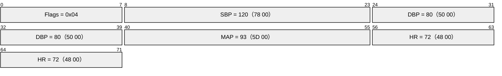
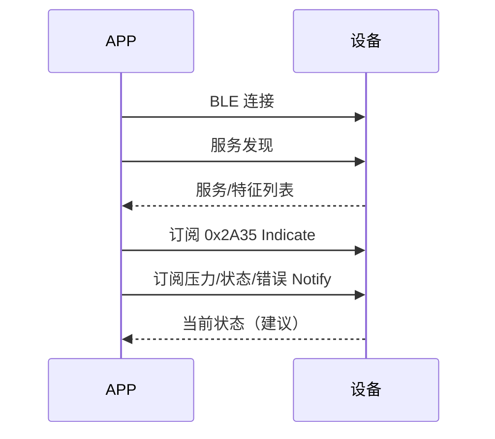
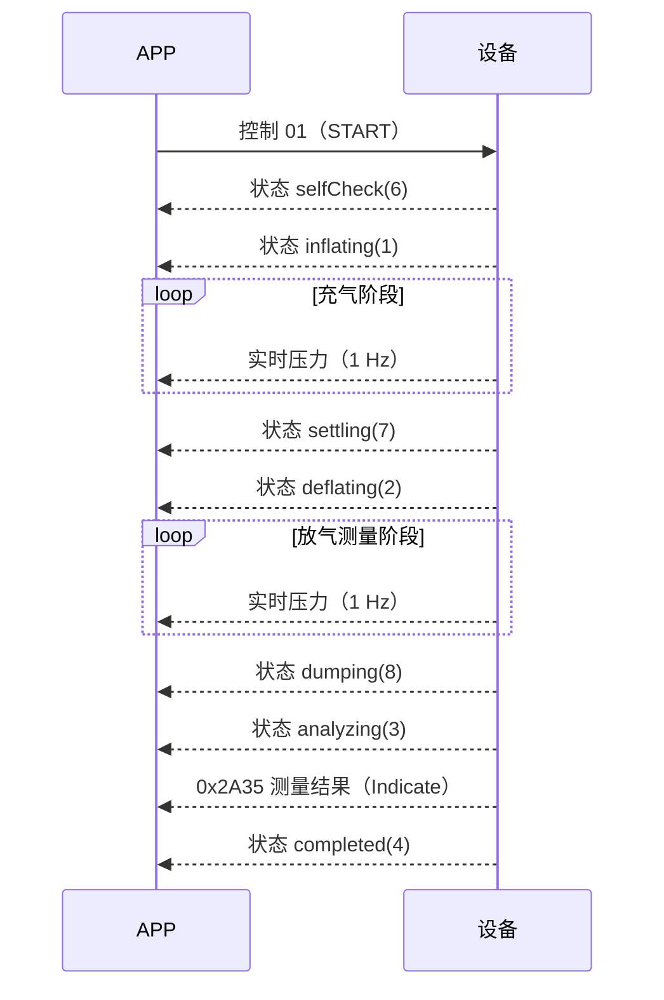
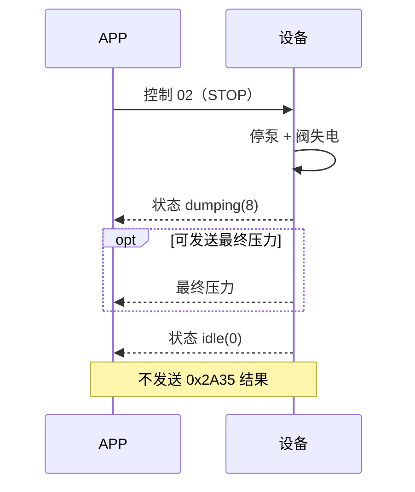
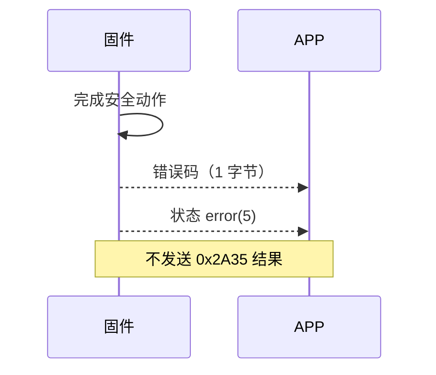
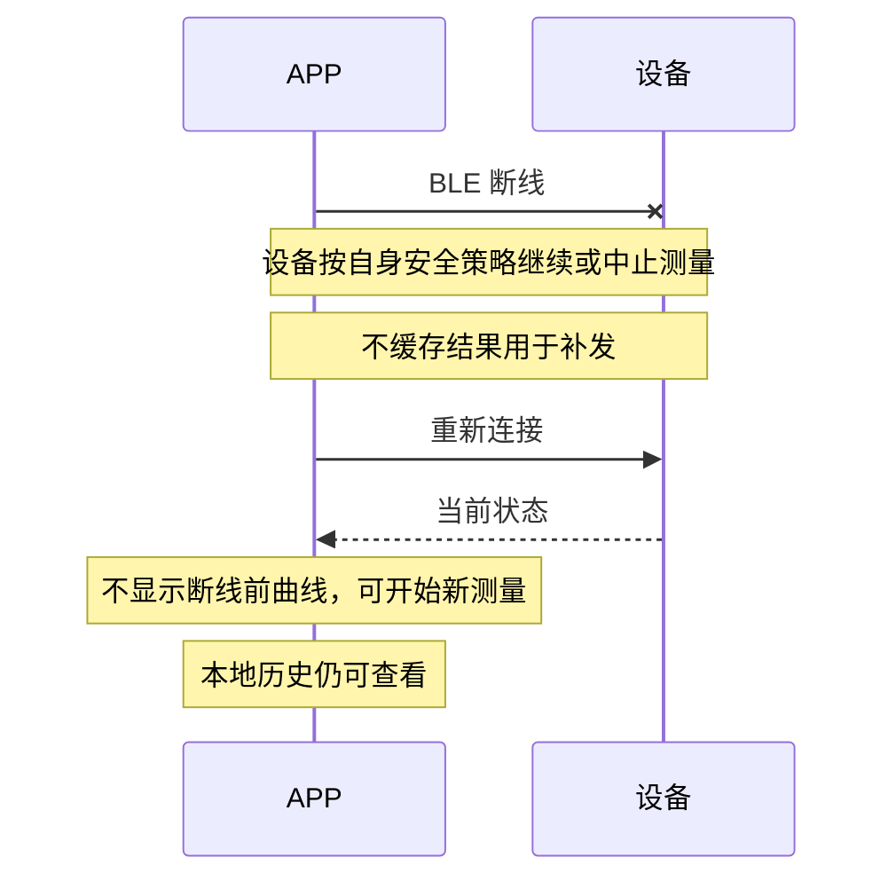

# BLE GATT 协议与联调约定

> **项目**：高校创新创业实践项目（2026） · 智能电子血压计
> **文件性质**：GATT 协议正本。结构、UUID、字节格式与状态/错误码已定；业务语义已填写，真机测试待执行。
> **当前状态**：v1.0 设计冻结（DESIGN FROZEN；真机验收见 §12.1）
> **协议版本**：v1.0
> **创建日期**：2026-10-30
> **最后更新**：2026-11-07
> **主笔**：APP 负责人（APP 侧现有实现与行为）
> **固件实现评审**：固件负责人（Pico 2W 板载 BLE 与驱动）
> **业务语义与最终冻结**：控制/集成负责人（测量状态、结果与错误语义）
> **唯一正本**：本文件。不得另建平行版本；历史差异由 Git 管理。

## 0. 基线与填写说明

### 0.1 基线

| 项目 | 内容 |
|---|---|
| APP 基线 APK | APP 侧内部构建（不公开） |
| APK 包名 / 版本 | `com.yourteam.bp_monitor_app` / `1.0.0` |
| APK SHA-256 | `b3e772db65d17171aab47b0e186c7b056ccfa874ea07491951b8cc82f75172bd` |
| APP 对应源码 commit | `404560337f17d04a5462607fed48a189bb6d27a5`（`main`，2026-10-30 APP 负责人确认） |
| 固件对应版本 | `snapshot-2026-11-07-wip` |
| 设备名称（广播名） | 【固件填写】 |

> 如果 APP 侧本地源码已经与上述 APK 不一致，必须先在第 0.2 节列出差异；否则本协议以该 APK 的实际行为为准。
>
> 这份模板只是降低填写门槛的起点，不是对 APP 实现的硬性约束。如果预填内容与她的实际代码或预期不符，她可以直接修改模板及相应内容，并在第 0.2 节简单记一句差异即可，不必因为“这是预填的”而迁就。

### 0.2 基线与现实源码的已知差异

**无。** APP 侧确认源码 commit `404560337f17d04a5462607fed48a189bb6d27a5` 重建的 APK 与基线 APK 的 SHA-256 一致，协议行为以基线 APK 为准成立。

```text
差异 1：无
影响：无
建议处理：无
```

### 0.3 填写标记

| 标记 | 含义 |
|---|---|
| 【已预填｜APP 核对】 | 已从 APK 提取，APP 负责人只核对，不需要重新设计 |
| 【已预填｜固件核对】 | 已从 APK/计划整理，固件负责人确认 Pico 侧能否按此实现 |
| 【APP 行为】 | APP 当前行为或 APP 侧待确认事项（APP 侧已回复） |
| 【固件填写】 | Pico/固件实现方式、限制或实测结果 |
| 【业务语义】 | 测量状态、结果、错误等业务语义（Z1–Z7 已填写，2026-11-07） |
| 【共同确认】 | 影响双方实现，必须评审后共同确认 |
| 【待实测】 | 当前无法仅靠代码确认，必须真机或联调验证 |
| 【永久不支持】 | 已决定不实现，不再作为后续功能讨论 |

填写规则：

1. **APP 负责人第一轮只需完成第 10.1 节的 L1–L9**；其余标记由对应负责人处理，不需要 APP 侧代填；
2. 只修改自己负责的标记项，不直接改写他人结论；
3. 无法确认时填【待实测】，不要猜一个确定值；
4. “没有此功能”直接写“无”，不要留空；
5. 填写完成后，在第 11 节登记未决项；
6. 测试通过前，文档状态不得改为“已冻结”。

---

## 1. 目标与范围

### 1.1 本期必须支持

| 编号 | 功能 | 说明 |
|---|---|---|
| F-01 | 扫描与连接 | 手机连接 Pico 2W 板载 BLE |
| F-02 | 实时袖带压力 | 测量过程中显示压力曲线与当前值 |
| F-03 | 测量结果 | SBP（高压）、DBP（低压）、MAP、HR（心率） |
| F-04 | 启动 / 停止 | APP 控制设备开始或中止测量 |
| F-05 | 状态提示 | 充气、放气、分析、完成、错误等 |
| F-06 | 错误提示 | 判废或故障时不展示假结果 |
| F-07 | APP 本地历史 | APP 保存已经成功接收的结果 |

### 1.2 永久不支持

以下内容不是“后续再做”，而是本项目明确不实现：

| 编号 | 永久不实现 | 约束 |
|---|---|---|
| N-01 | 设备端历史记录存储 | 不实现机内历史缓存、Flash 历史文件或数据库 |
| N-02 | 设备历史记录同步 | 不设计查询、上传、删除、补发历史记录的 GATT 特征或指令 |
| N-03 | 关机后数据恢复 | 设备关机后，本次测量临时数据和未成功发送的结果不保留 |
| N-04 | 断线后结果补发 | 重连后不补发断线期间的测量结果，只允许开始新测量 |
| N-05 | JDY-23 或其他外置蓝牙模块 | 不设计 UART 透传、AT 指令或模块兼容层 |
| N-06 | 备用自定义帧 | 不使用 `AA 55 + CMD + LEN + DATA + CRC8`，不定义串口波特率与重发 |
| N-07 | 双蓝牙承载兼容 | APP 与固件只维护当前 Pico 2W 板载 BLE GATT 一套协议 |

必须区分：

> **APP 本地历史 ≠ 设备历史同步。**
> APP 收到一次有效结果后，可以写入手机本地数据库并在历史页展示；该数据只属于手机，不从设备同步，也不受设备关机影响。

### 1.3 暂不纳入 V1（与永久不支持不同）

以下功能暂不进入第一轮联调，后续是否增加另行评审：

- 设备时间戳；
- 不规则脉搏、体动、袖带贴合等质量标志展示；
- 多用户配置同步；
- 参数设置；
- OTA 固件升级；
- 设备端测量备注、体重、姿势等附加信息。

其他必须纳入本期的事项：

当前无其他事项。

---

## 2. 通信架构

| 项目 | 约定 |
|---|---|
| 手机角色 | BLE Central |
| 设备角色 | BLE Peripheral |
| 设备硬件 | Raspberry Pi Pico 2W 板载 BLE |
| 结果承载 | 标准 Blood Pressure Service `0x1810` |
| 实时数据与控制承载 | 自定义 GATT 服务／特征 |
| 应用层帧头 | 无 |
| 应用层 CRC | 无；依赖 BLE/GATT 链路校验 |
| 应用层 ACK | 无；控制命令以 GATT Write Response 作为传输确认 |

> 设计原则：APP 已按 GATT 特征解析。固件直接产生对应特征值，不再在特征值外再包一层 `CMD/LEN/CRC` 帧。

---

## 3. 扫描、连接与订阅

### 3.1 广播

| 项目 | 约定 | 负责人 |
|---|---|---|
| 广播名称 | 【固件填写】 | 固件负责人 |
| 可连接 | 是 | 固件负责人 |
| 广播中必须包含的服务 | `0x1810` | 固件负责人 |
| 是否广播自定义服务 UUID | 【固件填写；不强制】 | 固件负责人 |
| 配对／绑定 | 【固件填写；当前 APP 不主动配对】 | 固件负责人 |
| MAC 地址类型 | 【固件填写；固定/随机】 | 固件负责人 |

> APP 的扫描过滤条件是广播中包含 `0x1810`。如果固件只在连接后提供 `0x1810`、但广播中不带该服务，APP 将扫描不到设备。

### 3.2 连接参数与 MTU

| 项目 | 约定 | 负责人 |
|---|---|---|
| APP 是否主动请求 MTU | 否，当前使用默认 MTU | 【已预填｜APP 核对】 |
| 固件是否依赖 MTU > 23 | 【固件填写；原则上不得依赖】 | 固件负责人 |
| 单包最大有效载荷 | 不超过默认 ATT 载荷（20 字节） | 固件负责人 |
| 连接间隔要求 | 【固件填写；无特殊要求写“无”】 | 固件负责人 |
| 自动重连 | 【APP 填写；当前不支持则写“无”】 | APP 负责人 |
| 连接超时 | 无显式超时，使用系统默认；扫描超时 10 s | APP 负责人 |

### 3.3 服务发现与订阅

连接成功后，APP 执行：

1. 发现全部 GATT 服务；
2. 订阅 `0x2A35` 的 Indicate；
3. 订阅实时压力、状态、错误三个自定义特征的 Notify；
4. 找到控制特征，用于后续 Write。

| 项目 | 约定 | 负责人 |
|---|---|---|
| 订阅失败时 APP 行为 | 特征缺失/不支持 Notify/Indicate 时静默跳过该特征；连接整体失败进入错误态并提示“连接失败” | APP 负责人 |
| 连接后是否主动推送一次当前状态 | 【固件填写；建议推送一次】 | 固件负责人 |
| 连接后是否主动推送一次当前压力 | 【固件填写；建议仅在测量中】 | 固件负责人 |
| CCCD 是否必须存在 | 是，Notify/Indicate 特征必须提供 CCCD | 固件负责人 |

### 3.4 断线与重连语义

| 场景 | 约定 | 负责人 |
|---|---|---|
| 测量中 BLE 断开 | **不影响设备本机测量与安全动作，继续测量**；断线期间结果不缓存、不补发；重连后开始新会话，不显示断线前曲线 | 控制/集成负责人 |
| 断线期间结果如何处理 | 不补发；若结果未成功发送则丢弃 | 控制/集成负责人 |
| 重连后是否显示断线前曲线 | 否，重新开始新会话 | 控制/集成负责人 |
| 重连后是否同步设备历史 | 【永久不支持】 | — |
| APP 本地历史是否保留 | 是，已保存到手机的记录不因 BLE 断开或设备关机消失 | APP 负责人 |

---

## 4. GATT 服务与特征总表

### 4.1 标准血压服务

| 项目 | 值 |
|---|---|
| 服务 UUID | `00001810-0000-1000-8000-00805f9b34fb` |
| 特征 UUID | `00002a35-0000-1000-8000-00805f9b34fb` |
| 特征名称 | Blood Pressure Measurement |
| 属性 | **Indicate**（必需） |
| CCCD | 必需 |
| 方向 | 设备 → APP |

### 4.2 自定义服务

| 用途 | UUID | 属性 | 方向 |
|---|---|---|---|
| 自定义服务 | `6e400001-b5a3-f393-e0a9-e50e24dcca9e` | — | — |
| 实时压力 | `6e400002-b5a3-f393-e0a9-e50e24dcca9e` | Notify + Read | 设备 → APP |
| 测量状态 | `6e400003-b5a3-f393-e0a9-e50e24dcca9e` | Notify + Read | 设备 → APP |
| 错误码 | `6e400004-b5a3-f393-e0a9-e50e24dcca9e` | Notify + Read | 设备 → APP |
| 控制命令 | `6e400005-b5a3-f393-e0a9-e50e24dcca9e` | **Write** | APP → 设备 |

> 控制特征必须支持带响应的 Write。APP 当前使用 `withoutResponse: false`，只提供 Write Without Response 不满足要求。

### 4.3 固件实现确认

| 检查项 | 结论 | 备注 |
|---|---|---|
| 能否同时注册 `0x1810` 与自定义服务 | 【固件填写：可实现/待实测/不支持】 | |
| 能否提供 Indicate 与 CCCD | 【固件填写】 | |
| 能否提供 3 个 Notify 特征 | 【固件填写】 | |
| 能否提供带响应 Write | 【固件填写】 | |
| 广播中能否包含 `0x1810` | 【固件填写】 | |
| BLE 实现库与版本 | 【固件填写】 | |

---

## 5. 数据格式

### 5.1 通用规则

| 项目 | 约定 |
|---|---|
| 字节序 | 小端 |
| 应用层帧头 | 无 |
| 应用层长度字段 | 无，长度由 GATT 特征值长度表示 |
| 应用层 CRC | 无 |
| 文本编码 | 不使用文本，全部为二进制 |
| 未定义字段 | 不得发送；不得用全 0 冒充有效结果 |

### 5.2 实时压力特征

| 项目 | 约定 | 负责人 |
|---|---|---|
| UUID | `6e400002-b5a3-f393-e0a9-e50e24dcca9e` | 已预填 |
| 数据长度 | 2 字节 | 已预填 |
| 类型 | `uint16` 小端 | 已预填 |
| 单位 | `0.1 mmHg` | 已预填 |
| APP 换算 | `raw / 10.0` | 已预填｜APP 核对 |
| 有效范围 | **0.0–300.0 mmHg**；0 有效（袖带通大气）；负值、NaN、>300.0 不发送，按 `OUT_OF_RANGE`/`SATURATED` 处理 | 控制/集成负责人 |
| 发送值来源 | **控制层校准后的袖带静态压力 `p_mmHg`（DC 分量）**，不是 AC 脉搏波；四舍五入到 0.1 mmHg；260/280 不钳低 | 控制/集成负责人 |
| 上报频率 | **1 Hz（1000 ms ±50 ms）** | 控制/集成负责人 |
| 发送阶段 | **SELF_CHECK、INFLATE、SETTLE、DEFLATE、DUMP**；ANALYZE/DONE/IDLE 不发送 | 控制/集成负责人 |
| 无效/未就绪时 | 不发送，不用 0 代替 | 控制/集成负责人 |
| 超范围时 | 不发送；进入 `OUT_OF_RANGE`/`SATURATED` 故障与安全流程；**260/280 仍按真实值发送** | 控制/集成负责人 |

编码示例：

| 实际压力 | 十进制原始值 | 发送字节 |
|---:|---:|---|
| 0.0 mmHg | 0 | `00 00` |
| 40.0 mmHg | 400 | `90 01` |
| 123.4 mmHg | 1234 | `D2 04` |
| 180.0 mmHg | 1800 | `08 07` |

APP 侧补充：

| 项目 | 内容 |
|---|---|
| 曲线最多保留点数 | 300 点【已预填｜APP 核对】 |
| 收到非法长度时行为 | 当前返回 0.0 显示；O-12 计划改为忽略该帧（不阻塞协议冻结） |
| 压力为 0 是否显示 | 是，正常显示 0.0 mmHg |
| 断线时曲线是否保留 | 否，断开即清空；重连后新会话重新绘制 |

### 5.3 测量结果特征（0x2A35）

#### 5.3.1 结构

| 偏移 | 长度 | 字段 | V1 约定 |
|---:|---:|---|---|
| 0 | 1 | Flags | 固定 `0x04`：单位 mmHg、无时间戳、含心率 |
| 1 | 2 | SBP | IEEE-11073 SFLOAT |
| 3 | 2 | DBP | IEEE-11073 SFLOAT |
| 5 | 2 | MAP | **必须发送**；APP 会无条件解析 |
| 7 | 2 | HR | V1 使用整数心率、SFLOAT 指数 0；与 APP 当前 uint16 解析字节相同 |

Flags：

| Bit | 含义 | V1 |
|---:|---|---|
| 0 | 0=mmHg，1=kPa | 0 |
| 1 | 是否含时间戳 | 0，V1 不发时间戳 |
| 2 | 是否含心率 | 1 |
| 3 | 是否含用户 ID | 0 |
| 4 | 是否含测量状态 | 0 |

> **HR 兼容说明**：标准 `0x2A35` 中 HR 为 SFLOAT，而当前 APP 代码按 `uint16` 读取。V1 约定 HR 为 40–180 的整数并使用 SFLOAT 指数 0，此时两种解析得到的字节完全相同。APP 负责人后续应将 APP 解析修正为标准 SFLOAT，不改变线上字节。

#### 5.3.2 发送规则

| 项目 | 约定 | 负责人 |
|---|---|---|
| 发送条件 | **仅 `DONE(OK)` 且 SBP/DBP/MAP/HR 均有效**；HR 缺失时控制层判 `REJECT`（`ANALYZER_NO_RESULT`）或 BLE 层降级为 `error(0x03)`，**不得发 HR=0 或空结果** | 控制/集成负责人 |
| 每次测量发送次数 | 1 次，不重复、不补发 | 控制/集成负责人 |
| 结果与完成状态的顺序 | **先 Indicate `0x2A35`，再 Notify `completed(4)`** | 控制/集成负责人 |
| REJECT 时是否发送 0x2A35 | 否，只发错误码与 `error(5)` | 控制/集成负责人 |
| FAULT 时是否发送 0x2A35 | 否 | 控制/集成负责人 |
| CANCEL 时是否发送 0x2A35 | 否，走 `dumping(8) → idle(0)` | 控制/集成负责人 |
| 无订阅者时 | 结果不缓存、不补发 | 【永久不支持补发】 |
| 数值精度 | SBP/DBP/MAP 0.1 mmHg；SFLOAT 指数 -1（整数值也可用指数 0）；HR 为 40–180 整数，SFLOAT 指数 0 | 控制/集成负责人 |
| MAP 缺失时 | 不允许发送结果，按 `REJECT`/`FAULT` 处理 | 控制/集成负责人 |

结果示例：



#### 5.3.3 APP 解析确认

| 项目 | 内容 |
|---|---|
| 当前 APP 是否解析时间戳 | 会跳过 7 字节，但不使用其内容【已预填｜APP 核对】 |
| 当前 APP 是否解析 HR | 按 `uint16` 小端读取【已预填｜APP 核对】 |
| 当前 APP 是否解析质量标志 | 否，`qualityFlag` 当前不会由 BLE 结果填充【已预填｜APP 核对】 |
| 判废/错误时 APP 如何避免显示旧结果 | 结果页只由 `0x2A35` 触发；每次进入测量页重置上一轮状态与结果缓存；错误路径无结果可显示 |
| 结果写入手机本地的时机 | 收到 `0x2A35` 且解析成功后立即写入手机 SQLite，不等 `completed`、不经用户确认 |

### 5.4 测量状态特征

| 项目 | 约定 |
|---|---|
| UUID | `6e400003-b5a3-f393-e0a9-e50e24dcca9e` |
| 数据长度 | 1 字节 |
| 类型 | `uint8` |
| 发送时机 | 状态变化时；连接后建议补发当前状态 |

状态码：

| Code | APP 枚举 | APP 显示文案 | 固件 FSM 状态 | 负责人 |
|---:|---|---|---|---|
| 0 | idle | 待机 | IDLE；`DONE(CANCEL)` 后续如何处理见 5.4.1 | APP/控制 |
| 1 | inflating | 充气中 | INFLATE | APP/控制 |
| 2 | deflating | 放气中 | DEFLATE | APP/控制 |
| 3 | analyzing | 分析中 | ANALYZE | APP/控制 |
| 4 | completed | 完成 | DONE(OK) | APP/控制 |
| 5 | error | 错误 | DONE(REJECT/FAULT) | APP/控制 |
| 6 | selfCheck | 自检中 | SELF_CHECK | APP/控制 |
| 7 | settling | 压力稳定中 | SETTLE | APP/控制 |
| 8 | dumping | 紧急排气中 | DUMP | APP/控制 |

#### 5.4.1 状态映射（已确认）

```text
DONE(CANCEL)：DUMP 到安全线后发 idle(0)；不发 completed(4)、不发 error(5)、不发 0x2A35。
STOP：先发 dumping(8)，再发 idle(0)；不发 0x2A35。
      即使 STOP 时压力已经低于 15 mmHg，也建议补发一次 dumping(8)，
      保持 APP 侧时序一致。
DONE(REJECT) / DONE(FAULT)：都发 error(5)，由 1 字节错误码区分。
IDLE：不周期重复发送；连接后补发一次当前状态。
状态码与错误码顺序：先发错误码，再发 error(5)。
```

### 5.5 错误码特征

| 项目 | 约定 |
|---|---|
| UUID | `6e400004-b5a3-f393-e0a9-e50e24dcca9e` |
| 数据长度 | 1 字节 |
| 类型 | `uint8` |
| 发送时机 | 判废、故障或需要用户重测时 |
| 正常完成时 | 不发送 |

APP 当前定义了 `0x01–0x05` 五个错误码。V1 不扩展错误码；FSM reason 只用于内部日志，BLE 只发送用户可行动的错误类别：

| Code | APP 当前含义/提示文案 | 对应 FSM reason | 是否允许重测 | 负责人 |
|---:|---|---|---|---|
| `0x01` | 袖带佩戴/连接问题 | `SELF_CHECK_FAILED`、`SELF_CHECK_TIMEOUT`、`SENSOR_COMM_FAIL`、`SENSOR_NOT_READY_TIMEOUT` | 是 | 控制/集成负责人 |
| `0x02` | 设备一般故障 | `SENSOR_STALE`、`SENSOR_SATURATED`、`SENSOR_OUT_OF_RANGE`、`SENSOR_SEQ_REGRESSION`、`ACTUATOR_FAILED`、`SAFE_STATE_FAILED`、`INFLATE_TIMEOUT`、`DEFLATE_STUCK`、`DUMP_TIMEOUT`、`TOTAL_TIMEOUT`、`BUFFER_OVERFLOW`、`ANALYZER_ERROR`、未知 reason | 是（建议先重启） | 控制/集成负责人 |
| `0x03` | 测量过程干扰（体动/说话等） | `DONE(REJECT)` 的全部 QC/判废 reason（如 `ANALYZER_REJECT`、`ANALYZER_NO_RESULT`、`ANALYZER_BAD_RESULT`） | 是 | 控制/集成负责人 |
| `0x04` | 压力异常，已安全排气 | `OVERPRESSURE_260`、`OVERPRESSURE_LATCHED_280`、`SELF_CHECK_PRESSURE_HIGH` | 是（检查后） | 控制/集成负责人 |
| `0x05` | 电池电量低 | `BATTERY_LOW`（当前 FSM 未实现；V1 保留码位，硬件具备电量检测后再启用） | 是（充电后） | 控制/集成负责人 |
| 其他 | 不扩展 | 未知 reason 统一归 `0x02` | 是 | 控制/集成负责人 |

补充：

- `USER_CANCEL`、`REASON_NONE`、`NO_ANALYSIS`：**不发错误码**。
- `DONE(REJECT)` 不按具体 QC 文本细分错误码；所有判废统一 `0x03`，避免把内部算法细节暴露给 APP。
- 发送顺序：**错误码 → `error(5)`**；不要先发 error 再发错误码。

发送顺序约定：

```text
REJECT / FAULT：
  1. 发送 1 字节错误码；
  2. 发送状态 error(5)；
  3. 不发送 0x2A35。

用户 STOP：
  不发送错误码；发送 dumping(8) → idle(0)；不发送 0x2A35。
```

### 5.6 控制命令特征

| 项目 | 约定 |
|---|---|
| UUID | `6e400005-b5a3-f393-e0a9-e50e24dcca9e` |
| 属性 | Write（带响应） |
| 数据长度 | 1 字节 |
| 其他长度 | 忽略并记录日志【固件填写错误处理】 |

| 值 | 含义 | 有效条件 | FSM 动作 | 负责人 |
|---:|---|---|---|---|
| `0x01` | 启动测量 | **仅 `IDLE` / `DONE`**；测量态、DUMP 忽略，不重启 | 转换为 `START` | 控制/集成负责人 |
| `0x02` | 停止测量 | **仅 `SELF_CHECK`/`INFLATE`/`SETTLE`/`DEFLATE`/`ANALYZE`**；`IDLE`/`DONE`/`DUMP` 忽略 | 转换为 `STOP`，执行安全动作 | 控制/集成负责人 |
| 其他 | 非法命令 | 忽略 | 不改变状态 | 固件负责人 |

控制行为补充：

| 问题 | 填写 |
|---|---|
| 测量中再次收到 START 如何处理 | 忽略；不重启、不排队 |
| IDLE 收到 STOP 如何处理 | 忽略；状态不变 |
| 控制命令是否需要业务 ACK | 无；GATT Write Response 仅代表传输成功 |
| 命令被忽略时 APP 如何知道 | V1 无业务 ACK；APP 发送后 2 s 内未观察到状态/压力变化，提示“设备未响应，请重试” |
| 写入失败时 APP 提示 | “指令发送失败，请重试” |
| 非法长度/未知命令 | 忽略并记录；不改变状态 |

> 说明：上表只约束 BLE 下行控制。固件 BLE 适配层在 `DONE`/`IDLE`/`DUMP` 直接丢弃 `0x02`，
> 不注入 FSM；本地按键的 STOP 仍按 FSM 内部语义处理（`DONE` 下回 `IDLE`），两者不冲突。

---

## 6. 通信时序

### 6.1 连接与订阅



### 6.2 正常测量



顺序说明：

- 结果先于 `completed`，保证 APP 进入结果页时已有结果；
- 状态切换和压力上报不得阻塞 80 Hz 采样与安全判断；
- 只有 `DONE(OK)` 才出现结果与 `completed`。

### 6.3 用户停止



### 6.4 判废或故障



### 6.5 断线与重连



---

## 7. 数据生命周期

| 数据 | 设备端 | APP 端 |
|---|---|---|
| 实时压力样本 | 仅运行期使用 | 曲线展示，可临时保存 |
| 完整 DEFLATE 缓冲 | 仅运行期分析使用 | 不传输 |
| 测量结果 | 运行期可显示一次，关机丢失 | 收到后写入本地历史 |
| 错误码 | 运行期使用，关机丢失 | 展示，不写入成功历史 |
| 设备历史记录 | **永久不保存** | **不从设备同步** |
| APP 本地历史 | — | 由手机本地数据库负责 |

设备重启后的正确行为：

- 无历史记录可查询；
- 无“上次结果”；
- 无断线结果补发；
- APP 历史页只显示手机此前已经保存的结果。

---

## 8. 非功能约束

| 约束 | 要求 | 负责人 |
|---|---|---|
| 采样不被阻塞 | BLE 发送不得影响压力采样和安全监督 | 固件负责人 |
| 单次发送最大阻塞时间 | 【固件填写并实测】 | 固件负责人 |
| BLE 发送失败 | 只降级记录，不触发测量判废，不影响安全动作 | 控制/固件 |
| 通知频率 | 压力 V1 为 1 Hz；状态仅在变化时发送 | 三方 |
| 数据包长度 | 不超过默认 MTU 可承载范围 | 固件负责人 |
| 断线时安全动作 | 不受 BLE 连接状态影响；设备继续本机测量与安全动作 | 控制/集成负责人 |
| 结果可靠性 | 无应用层 ACK/重传；发送失败丢弃，不补发历史 | 控制/集成负责人 |
| 时间同步 | V1 不使用设备时间戳；APP 使用手机时间 | 控制/集成负责人 |

---

## 9. 固定测试向量

> 所有多字节整数均为小端。双方必须用相同字节得到相同结果。

### 9.1 广播与连接

| ID | 测试项 | 预期 | 鲁实测 | 余实测 | 结论 |
|---|---|---|---|---|---|
| BLE-01 | 广播中包含 `0x1810` | APP 真机模式能扫描到设备 | APP | 固件 | 待填 |
| BLE-02 | 连接并发现服务 | 找到 1 个标准服务和 1 个自定义服务 | APP | 固件 | 待填 |
| BLE-03 | 订阅 4 个通知特征 | 订阅全部成功 | APP | 固件 | 待填 |

### 9.2 实时压力

| ID | 输入字节 | 预期 APP 显示 | 鲁实测 | 余实测 | 结论 |
|---|---|---|---|---|---|
| BLE-10 | `00 00` | 0.0 mmHg | APP | 固件 | 待填 |
| BLE-11 | `90 01` | 40.0 mmHg | APP | 固件 | 待填 |
| BLE-12 | `D2 04` | 123.4 mmHg | APP | 固件 | 待填 |
| BLE-13 | `08 07` | 180.0 mmHg | APP | 固件 | 待填 |

### 9.3 测量结果

固定输入：

```text
04 78 00 50 00 5D 00 48 00
```

| 字段 | 预期值 | 鲁实测 | 余实测 |
|---|---:|---|---|
| Flags | 0x04 | APP | 固件 |
| SBP | 120 mmHg | APP | 固件 |
| DBP | 80 mmHg | APP | 固件 |
| MAP | 93 mmHg | APP | 固件 |
| HR | 72 bpm | APP | 固件 |
| 结论 | 全部一致 | APP | 固件 |

### 9.4 控制、状态与错误

| ID | 测试项 | 预期 | 鲁实测 | 余实测 | 结论 |
|---|---|---|---|---|---|
| BLE-20 | 写入 `01` | FSM 收到 START，进入自检/充气 | APP | 固件 | 待填 |
| BLE-21 | 测量中写入 `02` | 停泵、阀失电、最终进入 idle | APP | 固件 | 待填 |
| BLE-22 | 正常完成 | 有结果，状态 completed | APP | 固件 | 待填 |
| BLE-23 | 算法判废 | 有错误码、状态 error、无结果 | APP | 固件 | 待填 |
| BLE-24 | 设备故障 | 安全动作完成、有错误码、无结果 | APP | 固件 | 待填 |
| BLE-25 | 测量中断线 | APP 显示断开；重连不补发结果 | APP | 固件 | 待填 |
| BLE-26 | 设备断电重开 | 无设备历史；APP 本地历史仍存在 | APP | 固件 | 待填 |

### 9.5 异常输入

| ID | 测试项 | 预期 | 负责人 |
|---|---|---|---|
| BLE-30 | 控制特征写入 0 字节 | 忽略，不改变状态 | 固件负责人 |
| BLE-31 | 控制特征写入 2 字节 | 忽略，不改变状态 | 固件负责人 |
| BLE-32 | 控制特征写入未知命令 | 忽略并记录 | 固件负责人 |
| BLE-33 | 未订阅时完成测量 | 不缓存结果、不补发 | 三方 |

---

## 10. 填写清单

### 10.1 APP 负责人【已回复 2026-10-30】

> 详细内容为内部评审记录，不公开。

- [x] L1：填写 APP 对应源码 commit；
- [x] L2：列出源码与基线 APK 的差异（确认无差异）；
- [x] L3：确认订阅失败、断线、重连的 APP 行为；
- [x] L4：补全状态 0–8 的实际显示文案；
- [x] L5：补全错误码 `0x01–0x05` 的含义与提示；
- [x] L6：确认结果写入手机本地的时机；
- [x] L7：确认 HR 当前按 `uint16` 解析，并承诺后续改为 SFLOAT；
- [x] L8：填写第 9 节“鲁实测”列（目前仅代码级；全部真机项仍为【待实测】）；
- [x] L9：确认没有设备历史查询或补发逻辑。

### 10.2 固件负责人

- [ ] Y1：填写设备广播名、MAC 类型、BLE 库版本；
- [ ] Y2：确认能否同时注册 `0x1810` 与自定义服务；
- [ ] Y3：确认 Indicate、Notify、CCCD、带响应 Write 全部可实现；
- [ ] Y4：确认广播包含 `0x1810`；
- [ ] Y5：给出 1 Hz 压力上报的非阻塞实现方式；
- [ ] Y6：确认控制字节 `01/02` 到 FSM 事件的转换位置；
- [ ] Y7：填写 BLE 发送最大阻塞时间和失败处理；
- [ ] Y8：填写第 9 节全部“余实测”列。

### 10.3 控制/集成负责人（业务语义）

- [x] Z1：确认压力有效范围、发送阶段和值来源（2026-11-07，见 §5.2）；
- [x] Z2：确认状态码映射，尤其是 `DONE(CANCEL)`（见 §5.4.1）；
- [x] Z3：确认错误码与 FSM reason 的映射（见 §5.5，按用户可行动类别归并）；
- [x] Z4：确认只有 `DONE(OK)` 发送 0x2A35（见 §5.3.2）；
- [x] Z5：确认结果与 `completed` 的发送顺序（先结果，后 completed）；
- [x] Z6：确认测量中断线与重连语义（见 §3.4）；
- [x] Z7：确认异常输入和命令被忽略时的产品行为（见 §5.6）。

---

## 11. 未决项

| ID | 问题 | 类型（阻塞冻结/不阻塞） | 负责人 | 截止 | 状态 |
|---|---|---|---|---|---|
| O-11 | APP 的 HR 解析由 `uint16` 改为标准 IEEE-11073 SFLOAT；V1 线上字节不变 | 不阻塞冻结 | APP 负责人 | 冻结前 | 未关闭 |
| O-12 | 压力帧长度非法时当前显示 `0.0`，拟改为忽略该帧并补 0/1/3 字节测试 | 不阻塞冻结 | APP 负责人 | 冻结前 | 未关闭 |
| O-13 | 控制命令无业务 ACK，命令被忽略时 APP 无感知；已约定 APP 发送后 2 s 未观察到状态/压力变化则提示“设备未响应，请重试” | 不阻塞设计冻结 | APP/控制 | 冻结评审 | 已约定，待 APP 实现 |
| O-14 | APP 未捕获 Write 异常，拟补充“指令发送失败，请重试”提示 | 不阻塞设计冻结 | APP 负责人 | 冻结前 | 未关闭 |
| O-15 | 第 9 节全部真机实测项需 Pico 设备到位后联调 | **阻塞整机验收**（不阻塞设计冻结） | APP/固件 | 下周联调 | 未关闭 |
| O-16 | APP 对缺失/不支持通知或指示的特征静默跳过，可能出现“已连接但无压力/结果”；需决定连接不可用提示或明确降级 | 不阻塞冻结 | APP 负责人 | 下周联调前 | 未关闭 |

---

## 12. 冻结与变更规则

### 12.1 冻结条件

> 注：本文件当前状态是 **v1.0 设计冻结（DESIGN FROZEN）**，表示结构/字节/语义不再改；
> 以下条件是 **整机验收冻结**，真机测试通过后再宣布。

协议从“设计冻结”改为“整机验收冻结”必须同时满足：

1. 第 10 节三方填写清单完成；
2. 第 11 节所有“阻塞冻结”问题关闭；
3. 第 9 节固定测试向量由 APP 和固件双方得到相同结果；
4. 广播、订阅、压力、结果、控制、错误六类测试至少各通过一次；
5. 三方在群内明确确认冻结版本。

### 12.2 冻结后的变更

任何字段、UUID、单位、状态码或错误码变化，必须登记：

```text
修改字段：
旧值：
新值：
修改原因：
APP 是否需要修改：
固件是否需要修改：
三方确认记录：
```

未登记的单方修改不生效；APP 与固件不得各自维护不同版本。

### 12.3 本文件明确不承诺的内容

- 设备端历史记录；
- 断线结果补发；
- JDY-23 或任何外置蓝牙模块兼容；
- UART 透传；
- `AA55` 自定义帧；
- 应用层 CRC、ACK、重传；
- 关机后数据恢复。

以上内容即使在其他文档或旧计划中出现，也以本文件第 1.2 节为准。

---

## 13. 评审进度记录

### 13.1 2026-11-01：APP 侧已回复

APP 负责人已按第 10.1 节完成 L1–L9 的书面回复；内部评审记录不公开。

当前结论：

- L1–L7、L9 已基本闭环；L8 仅完成代码级验证，全部真机项仍为【待实测】。
- APP 源码 commit 为 `404560337f17d04a5462607fed48a189bb6d27a5`，与基线 APK 无已知差异。
- APP 认可现有 GATT 服务、UUID、数据格式及“设备不保存/不补发历史”的边界，无需重新设计协议。
- APP 确认手动重连、结果收到后立即写入手机 SQLite、断线清空曲线且不补发。

### 13.2 2026-11-07：业务语义填写与设计冻结

- 控制/集成负责人完成 Z1–Z7：压力范围/来源/阶段、状态映射、错误码归并、结果发送规则、断线语义、控制语义。
- GATT 结构、UUID、字节格式、状态码 0–8、错误码 1–5 均保持不变；本文件状态更新为
  **v1.0 设计冻结（DESIGN FROZEN）**。
- 真机测试（BLE-01–33）仍为 O-15，作为验收项单独跟踪；未通过真机测试前不宣称“整机验收通过”。

### 13.3 下一步

| 事项 | 负责人 | 完成标准 |
|---|---|---|
| 实现 Pico 2W GATT 服务端与 1 Hz 压力/结果/控制映射 | 固件负责人 | APP 可发现设备并完成最小联调链路 |
| Pico 2W BLE bench（合成数据） | 控制/集成负责人、固件负责人 | APP 真机完成扫描/连接/订阅/启动/结果/错误/停止 |
| 关闭 O-11、O-12、O-14，处理 O-16 | APP 负责人 | APP 异常输入和订阅失败不再静默 |
| 完成第 9 节真机测试，关闭 O-15 | APP/固件 | 第 12.1 节冻结条件全部满足 |
