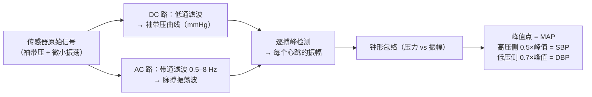
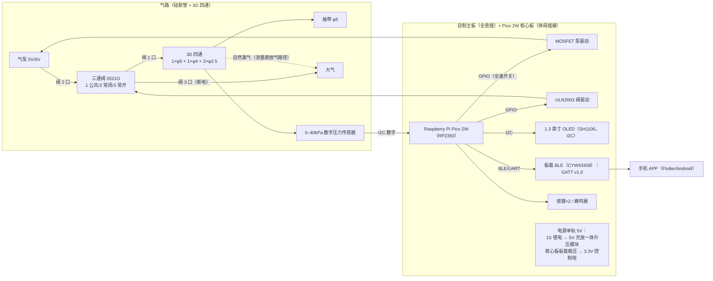
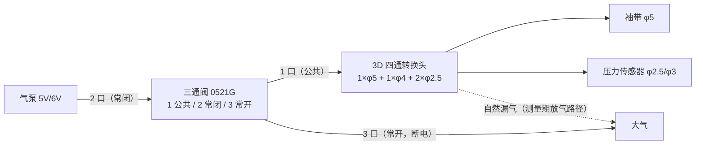
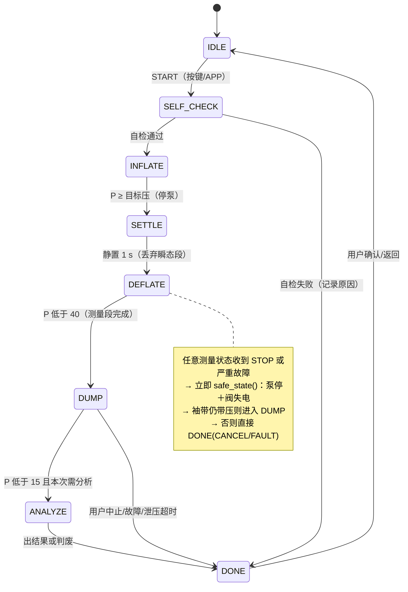

# 技术实施计划（方案决策 + 技术细节 + 风险分析）

> **项目**：高校创新创业实践项目（2026） · 智能电子血压计（便携臂式、示波法、5 人小组）
> **版本**：**v2.9**（2026-10-25）——**第 6 周收口与偏差修正**：① 控制分工按 v2.7 执行（固件负责人收敛为平台与器件驱动，组长接管状态机、安全监督、主循环与整机集成）；② 算法固件化按 v2.8 完成 PC 侧对拍，尚未上真机；③ 原理图 V1.0 评审发现 4 项会直接导致打样返工的问题（泵/阀负载与续流二极管、传感器型号、无关器件/5V 进 3.3V、电源网络命名），该版即当前所称“定稿”，复核前不得作为采购/打样依据；④ 气路 4 通拓扑可保留，但阀的默认态必须满足“断电即泄压”（三通阀或常开泄压阀＋单向阀），二通常闭阀只作调试件；⑤ 采集链仍未定版（数字主链接口/速率未实测、HX711 仅读到数），采样数据契约未定稿；BLE GATT v1.0 已于 2026-11-07 设计冻结，正本为 `docs/interfaces/ble-gatt-protocol.md`。相对历史版本的变更见文末《附录：变更记录》
> **文档性质**：方案决策与实施计划。第 0 章基础扫盲（新手先读）；第 1 章总体方案；第 2 章各子系统**上/中/下三档对比与选型理由**；第 3–5 章落地细节；第 6–8 章测试/BOM/排期；第 9 章风险分析
> **输入**：phase1-landscape.md、phase2-closure.md（V1–V8 台账）、phase2-bom-budget.md、12 份 phase2-*.md（检索日 2026-09-14）；2026-10-19 采购实物反馈（传感器数字输出/5V 泵/三通阀/3D 四通/口径实测）；2026-10-23 控制分工与 MVP 范围评审；2026-10-24 第二阶段固件对拍与预算实测（`firmware/docs/coverify.md`、`firmware/docs/budget.md`）；2026-10-25 第 6 周节点检查、原理图 V1.0 评审、气路拓扑评审
> **决策原则**：① **做成优先**（中策为主，完备只留给有回报的地方）；② 直插工艺优先（无热风枪）；③ 断电安全（失电即泄压）；④ 每一步可实物验证（MVP 先行：面包板 → PCB）；⑤ 预算分层（150 报销 + 可承受自费）；⑥ **接口优先**（跨模块连接先出接口表，再采购/画板）
> **待确认**：标注「⚠ 待导师」的决策依赖课程边界/资源确认（清单见 phase2-closure.md §4①）；标注「⚠ 待实测」的参数需按第 6 章测试计划验证后锁定；气路接口表/四通端口映射见 §3.7.1
>
> **⚠ BLE 协议状态（2026-11-07）**：GATT v1.0 已设计冻结，唯一正本为 `docs/interfaces/ble-gatt-protocol.md`。本文所有“JDY-23 / AA55 自定义帧 / UART 透传 / 帧格式未定稿”表述均为历史方案，不再作为回退路径；冲突时以 GATT 正本为准。

---

## 0. 基础概念扫盲（给第一次做嵌入式整机的队友）

> 本章用白话解释「这台机器怎么工作、每个零件干什么、需要懂哪些概念」。看懂本章后再读后面各章的设计细节就不会迷路。已熟悉的同学可跳过。

### 0.1 这台机器怎么量血压（示波法原理）

1. 袖带绑在上臂，气泵把袖带充到约 180 mmHg，把手臂动脉**完全压瘪**（血流中断）；
2. 缓慢放气，袖带压力逐渐下降。当压力降到**收缩压（SBP，高压）**附近，血液开始冲开动脉，每次心跳在袖带里产生一个微小的压力波动（**振荡波**，只有 1–3 mmHg）；
3. 压力继续下降，动脉开得越来越大，振荡波幅度**先变大后变小**；把每个心跳的振幅连起来得到一个**钟形包络**，包络**最高点**对应的压力≈**平均压（MAP）**；
4. 工程判定（特征比法）：包络峰值 × 一个比例——**高压侧约 0.5 倍处 = SBP，低压侧约 0.7 倍处 = DBP**（舒张压，低压）；
5. 心跳间隔 = 心率。全程 1–1.5 分钟，然后快速放气。

**为什么难**：① 振荡波只有袖带压的约 1/1000 量级（电压 0.1–0.3 mV），需要高分辨率 ADC 和滤波才能挖出来；② 特征比因人而异（这也是两台商用血压计读数也不完全一致的原因）；③ 放气快慢直接影响包络质量。

### 0.2 每个零件是干什么的

| 零件 | 是什么 | 在本机干什么 | 为什么选它 |
|---|---|---|---|
| 0–40kPa 数字压力传感器模块（I2C/数字输出） | 自带放大＋采样、直接输出数字信号；量程 0–40kPa（=300mmHg） | 把袖带压力变成数字读数（主用 I2C） | 免 ADC 设计、出厂校准；首次目标 180mmHg，180×1.3=234<300，40kPa 足够；E1 验证速率/分辨率 |
| MPS20N0040D＋HX711 模块（回退链，E1 不达标时启用） | 裸桥传感器（压力→毫伏电压）＋24 位 ADC 模块 | 数字模组验证不达标时的采集链回退 | 已论证可行（挑片＋B/32 档）；建议同批备 1 套或提前锁定链接 |
| Pico 2W 核心板 | 单片机最小系统板（RP2350 双核 Arm Cortex-M33，板载 BLE） | 整机大脑：控制泵阀、跑算法、驱动屏幕和蓝牙 | 可单步调试、硬件 FPU、板载蓝牙；排母插在我们自制主板上（v2.5） |
| 微型隔膜气泵（5V/6V 额定均可；MAP-AM-265 为参考） | 微型隔膜气泵 | 给袖带充气 | 5V 额定款可直接挂单轨 5V；MAP-AM-265 6V 为商用拆机同款、官方参数齐全 |
| 三通电磁阀（1 公共/2 常闭/3 常开） | 单只三通阀：通电 1–2 通，断电 1–3 通 | 单阀作“泵/大气选择”：通电泵–袖带（充气/保压），断电袖带–大气（快排）；测量期泵停，靠泵单向阀保压＋自然漏气放气 | 断电 1–3 通大气 → 任何故障/断电自动泄压；先只装 1 只，慢阀 E3 后再定 |
| 手动针阀（装于四通备用口） | 人工拧动的小针阀，常态关死 | ① 应急手动泄压（真人上臂测试的安全冗余）；② E3 判漏气过慢时拧至固定开度 ≈ 可调慢阀 | 一物两用；零驱动、约 ¥3；常态关死不参与测量气路（v2.3） |
| ULN2003 | 7 路达林顿驱动阵列（DIP-16，内置续流二极管） | 驱动气阀（空余路可带蜂鸣器）：阀按实测（ULN2003 单路 ≤500 mA），MCU 引脚（几 mA）推不动 | 导师建议的阀驱动标准件；免设计免调试；各组可拼单 |
| IRLZ44N | N 沟道 MOSFET（电子开关） | 开关气泵（430–600 mA） | 导通电阻约 0.05 Ω，几乎不发热 |
| 1N5819 | 肖特基二极管 | 给泵/阀线圈的反电动势提供泄放回路（**续流**），保护驱动管 | 电感断电瞬间产生高压尖峰，不接会打坏管子 |
| 5V 充放一体升压模块 | 充电＋保护＋升压三合一（IP5306/ETA9740 类，锂电→5V） | 锂电池变成稳定 5V 单轨（全机供电） | 一个模块顶 TP4056＋MT3608 两个；4×AA 供 5V 压差不够（导师指正） |
| 核心板板载稳压 | 核心板自带（Pico 2W 为 VSYS 1.8–5.5V→3.3V SMPS） | 给 MCU/传感器/屏幕/蓝牙供 3.3V（控制电） | 主板免装降压模块；到货核查 3.3V 输出电流 ≥300 mA（v2.5） |
| SH1106 OLED | 1.3 寸 I2C 屏 | 显示 SBP/DBP/心率 | 任务书要求 OLED；I2C 只要 2 根线 |
| JDY-23（历史备件） | BLE 串口透传模块 | 不再作为蓝牙退路；GATT v1.0 已定，APP 不支持透传 | v2.5 历史方案；采购件保留但不接入正式协议 |
| 1S 锂电池（18650＋电池盒） | 电源 | 全机供电（经一体升压模块出 5V） | 4×AA 无法稳定供 5V（导师指正）；可充电，≥50 次测量/充电循环 |

### 0.3 必须懂的 7 个电气概念（每条一句话）

1. **电压轨/地**：机内按电压分成几条"供电线"（轨）。我们只有两条：5V 驱动电（泵阀、全机总入口）+ 3.3V 控制电（芯片们，由核心板板载稳压从 5V 产生）。所有的地（GND）最终要连在一起，但大电流地回路要避开敏感小信号的地。
2. **去耦电容**：每个芯片电源脚旁边贴一个 100 nF 电容，相当于给芯片配一个"本地小水库"，它突然要电流时不会拉低整条电压轨。
3. **续流二极管**：泵和阀的线圈是电感，断电瞬间会产生反向高压尖峰（反电动势），二极管给它一条泄放回路，否则打坏驱动管甚至传感器。
4. **PWM**：固定频率的方波，调节"开的时间占比"（占空比）来等效调节平均功率/流量。本项目泵阀 MVP **不使用 PWM**；GP14 的 PWM 能力仅作硬件预留，默认让泵 MOSFET 全导通。
5. **比率式测量**：传感器的供电和 ADC 的参考电压接同一电源——电源抖一下，信号和参考一起抖，**比值不变，读数不受影响**。这是我们敢简化电源的底气之一。
6. **电平匹配**：不同电压的芯片互连要确认容限。我们特意让 MCU/传感器/屏幕/蓝牙全在 3.3V，**零电平转换**。
7. **上电默认态**：复位/掉电瞬间 MCU 引脚的状态决定泵阀的默认状态。我们设计成「默认 = 泵停 + 三通阀断电 1–3 通大气 = 泄压」，任何死机/断电都安全。

### 0.4 必须懂的 5 个软件概念

1. **状态机**：固件只有一个主循环，当前处于哪个"状态"（待机/充气/放气测量/快排/分析…）决定它干什么；条件满足就跳到下一个状态；任何状态检测到严重异常都先执行「泵停＋阀失电」安全动作。
2. **中断**：硬件事件（传感器数据就绪、串口收到字节、按键）会打断主循环优先处理，降低 80 Hz 采样丢样风险；实际丢样率按 E1 判据验收。
3. **采样定理**：要还原一个信号，采样率至少是信号最高频率的 2 倍。脉搏波最高约 8 Hz，我们目标采 80 Hz，余量 5 倍。
4. **滤波**：低通 = 去掉高频抖动（提取袖带压曲线）；带通 = 只留 0.5–8 Hz（提取脉搏波）。本机用二阶 IIR 数字滤波（一个几行的递推公式），系数先在 PC 上用 Python 算好再移植进固件。
5. **浮点与数值移植**：Pico 2W 的 Arm 核带硬件 FPU，但 MicroPython 不能直接运行 PC 端的 numpy/scipy 代码；滤波、统计和插值需用可用库或纯 Python 重写，并用同一份数据与 PC 版对拍。

### 0.5 各岗位最小学习清单（W5 启动，W6 前具备最小实操能力）

| 岗位 | 开工前必须会 | 学习方式建议 |
|---|---|---|
| 嵌入式平台与器件驱动 | MicroPython 建工程/点灯/串口打印；定时器与中断；I2C/GPIO 驱动；非阻塞采样；看懂驱动接口契约 | 树莓派 Pico MicroPython 官方文档＋实物 Demo |
| 算法与系统控制（组长） | Python numpy/scipy/matplotlib；滤波器基本概念；串口收 CSV；MicroPython 数值移植；状态机与 PC 对拍 | scipy/MicroPython 官方文档＋教程 |
| PCB | 立创 EDA 画原理图/布局走线；看懂数据手册引脚图 | 立创 EDA 官方教程（B 站） |
| 移动端 | Dart/Flutter 基础；flutter_blue_plus 示例跑通 | Flutter 官方 codelab |
| 外观结构 | 游标卡尺测绘；任一 3D 建模软件出外壳；气路密封常识 | B 站建模入门 + 实验室打印机培训 |

### 0.6 术语表

SBP/DBP = 收缩压/舒张压；MAP = 平均动脉压；mmHg = 毫米汞柱（1 kPa≈7.5 mmHg）；ADC = 模数转换器；BLE = 低功耗蓝牙；UART = 串口；I2C = 两线芯片总线；LDO = 线性稳压器；MVP = 最小可行样机；E1–E5 / T1–T8 = 本文第 6 章的实验/测试编号。

---

## 1. 总体方案

### 1.1 系统架构

**一句话方案（v2.9）**：**0–40kPa 数字压力传感器模块**（I2C/数字输出，自带放大＋ADC＋出厂校准；40kPa=300mmHg，首次 180×1.3=234<300 足够；回退＝MPS20N0040D＋HX711 模块 B/32 档挑片链）直采压力；**Raspberry Pi Pico 2W**（RP2350 双核，排母插接在自制主板）做主控，固件采用 **MicroPython**；放气期测量（**单只三通阀 1 公共/2 常闭/3 常开作泵-大气选择＋自然漏气放气**；先只装 1 只，备用慢阀 E3 后再定）；泵阀默认全速开关控制，不做 PWM/PID；安全 = 固件限压 + 片上看门狗（WDT）+ 三通阀断电 1–3 通大气（L2 独立比较器留作可选加分项）；单轨电源（1S 锂电＋5V 充放一体升压模块，3.3V 由核心板板载稳压供给；5V 或 6V 泵均可）；1.3" OLED 显示；**板载 BLE（MicroPython 蓝牙接口，GATT v1.0：0x1810 + 自定义服务）** + Flutter APP（Android）；气路用 **四通（1×φ5/1×φ4/2×φ2.5，可购件或 3D 打印）＋多规格硅胶管** 解决口径转换；**阀最终方案必须满足断电泄压（三通阀 1 公共/2 常闭/3 常开，或常开泄压阀＋单向阀），二通常闭阀只作调试件**。

### 1.2 测量流程（放气法）

1. 绑好袖带，按 START（本机按键或 APP 指令）；
2. 自检（基线、电量、传感器有效性）→ 泵全速充气至目标压（首次 180 mmHg；其后按上次 SBP+30，封顶 240；L1 保护 260/280）；180×1.3=234<300，40kPa 量程足够；
3. 停泵、静置 1 s（避开停泵瞬态）；三通阀保持通电（1–2 通，泵–袖带），泵停后靠泵单向阀保压；
4. 三通阀保持通电、泵停，气路经**自然漏气**缓慢放气（导师项目经验：自制气路气密性有限，天生等效一个常开慢速阀；速率 E3 标定决策门，目标测量带 2–5 mmHg/s（180→60），过慢则加装备用慢阀），同步采集并缓冲 DEFLATE 段压力样本；
5. 压力 < 40 mmHg → 三通阀断电（1–3 通大气），先快排至安全压力；MVP 不做在线包络提前结束；
6. 对缓冲的完整 DEFLATE 段做批处理包络分析：MAP=包络峰值处压力；SBP=高压侧比率点（初值 0.50）；DBP=低压侧比率点（初值 0.70）；心率=有效峰间期中位数换算；
7. 质量门控（峰数/一致性/节律）→ 通过则出结果，否则判废并提示重测；
8. OLED 显示 SBP/DBP/HR + 质量标志；经 BLE 上报 APP（存储历史、给健康建议）。

### 1.3 关键设计指标

| 指标 | 目标值 | 依据 |
|---|---|---|
| 压力量程 | 传感器量程 0–300 mmHg（首次 180；后续封顶 240；L1 保护 260/280） | 课程硬约束 ≤300；首次 180×1.3=234<300；后续封顶 240、L1 260/280，40kPa（=300mmHg）覆盖保护 280；100kPa 仅额外余量 |
| 静态压力精度 | 独立验证轮各点 ≤±3 mmHg（25 °C，拟合/验证数据分离，v2.3） | OIML/JJG 口径；可行性目标 ⚠ 待导师确认 ±3/±4 |
| 采样率 | ≥80 Hz（数字传感器与回退链均须满足；HX711 改接 RATE 后 80 Hz） | 0.5–8 Hz 信号带；80 Hz 为最高频率的 10 倍、Nyquist 下限的 5 倍 |
| 放气速率 | **自然漏气放气**：测量带（180→60 mmHg）目标 2–5 mmHg/s（E3 决策门 §4.6） | AHA/OIML 推荐 2–3（phase1-a）；导师项目经验（漏气≈常开慢阀）⚠ 待实测 |
| 充气时间 | 0→180 mmHg ≤ 15 s（泵 0→300/500cc ≤11.5 s） | 5V/6V 微型泵实测；MAP-AM-265 官方参考（pump） |
| 单次测量总时长 | 典型 60–85 s，固件硬超时 120 s | algorithm §Q5；标准累计 ≤180 s 留余量 |
| 超压保护 | L1 固件 260/280 mmHg + 片上硬件看门狗（WDT）；L3 三通阀失电 1–3 通大气＋自然漏气慢通道；L2 独立比较器 ≈275 mmHg（可选加分项） | safety §5（300/+10%≤3s/30s 泄至≤15） |
| 快速泄压 | 300→15 mmHg ≤ 5 s（限值 30 s，余量 ≥6×） | 三通阀 1–3 通大气实测；0521G/CJV13 标称 2–5 s（valve §①4） |
| 气密/放气边界 | E3/T2 分别标定测量放气与静态保压；静态 ≤6 mmHg/min 仅在测试路径和隔离条件明确后作为判据 | 自然漏气 2–5 mmHg/s 与静态 6 mmHg/min 不可同时无条件宣称，未闭环前列为开放项 |
| 心率范围/精度 | 40–180 bpm，±3 bpm（对照法） | 工程目标 |
| 重复性 | 同臂模拟器 5 次 SD ≤3 mmHg | calibration T6 ⚠ 待导师确认 |
| 对照精度 | vs 商用机：均值差 ≤±5 mmHg（10 人次序贯对照） | ISO 81060-2 准则 1 经验化 ⚠ 待导师确认 |
| 续航 | ≥50 次测量/充电循环（1S 锂电 1000 mAh，可充电） | 单次 60–100 J 推算（power ①5） |
| BLE | 板载 BLE ≥10 m（GATT v1.0）；Android APK（iOS 视团队设备 ⚠ 待导师） | mcu/ble |
| 定位 | **教学验证样机**：不做临床准确性宣称 | safety 4.3 ⚠ 待导师确认话术 |

---

## 2. 三档方案对比与选型决策

> 方法：每个子系统按**上策（完备）/ 中策（折中）/ 下策（应急）**三档评估，然后在「课程目标（做成＝功能实现＋工程过程得分）、团队能力（新手多）、剩余 12 周工期（W5–W16）、150＋预算」下选档。**默认中策**；个别子系统因「完备反而更简单」或「是主要矛盾」取上策。「性能损失」列量化回答「简化掉的东西到底值多少」。

### 2.1 各子系统三档对比

| 子系统 | 上策（完备） | 中策（折中） | 下策（应急） | **选择 + 性能损失** |
|---|---|---|---|---|
| 电源 | 两轨分域：5V 驱动电 / 自装 AMS1117 出 3.3V 控制电 | **单轨 5V：1S 锂电＋5V 充放一体升压模块（充电/保护/升压三合一）；3.3V 由核心板板载稳压供给** | 3×AA 无稳压直连全系统（泵速/低电风险） | **中策再简化（v2.2，导师背书；v2.5 稳压改由 Pico 2W 板载 SMPS 提供）**。损失：升压纹波 → E5 实测把关（数字传感器主链对纹波不敏感）；一体模块的轻载自动休眠坑 → 选无自动关机款、到货实测。4×AA→5V 不可行（buck 压差＋内阻跌落，§2.2） |
| 采集链 | **0–40kPa 数字压力传感器模块（I2C，24-bit，出厂校准，免前端设计）** | HX711 模块 B/32（±80 mV）＋ 3 只挑片 | XGZP6847A 模拟＋MCU 12-bit ADC（分辨率勉强） | **上策（v2.6 确认实物为数字输出）**——40kPa=300mmHg；首次 180，180×1.3=234<300，量程足够。E1 主卡速率/分辨率（≥80 Hz / ≤0.1 mmHg），另验量程与连续 120 s 丢样率。**回退＝HX711 链**，仅 E1 不达标时启用 |
| 阀/放气 | 单阀 PWM 闭环 2.5 mmHg/s（查表＋PI 标定） | **单只三通阀（1 公共/2 常闭/3 常开）作泵-大气选择＋自然漏气放气；先装 1 只；备用慢阀（CJV13-A3）预留；手动针阀作应急泄压/微调** | 手动针阀作唯一放气手段（半自动，不满足"自动排气"） | **中策（v2.6：单阀方案 A）**。通电 1–2 通=泵-袖带；断电 1–3 通=袖带-大气。损失：漏气率不可调 → E3 决策门；过慢先拧针阀、仍不足装慢阀；过快整改密封。收益：省 1 阀＋1 驱动、端口少、免标定 |
| 安全保护 | L1 固件＋L2 独立模拟通道硬件切断＋L3 失电泄压（对标 IEC 单故障） | **L1 固件＋片上硬件看门狗（WDT）＋L3 三通阀失电 1–3 通大气＋自然漏气慢通道** | 仅固件限压 | **中策**。损失：「MCU 死机且看门狗同时失效」的复合故障无保护（概率极低）；L2 留作可选加分项 |
| MCU | **Raspberry Pi Pico 2W 核心板（双核＋FPU＋板载 BLE）＋ MicroPython** | STM32F103 核心板（v2.4 前方案；CubeIDE＋ST-Link 调试链） | STC15F2K60S2（8051，DIP 全直插，极端退路） | **上策（v2.5 平台变更；v2.7 固件路线收口）**。优势：更强算力、板载 BLE、当前开发环境已跑通。损失：numpy/scipy 算法不能原样运行，需移植对拍；板载 BLE 的 GATT 服务端能力待实测 |
| PCB | 全分立自研（含 ADC 电路自绘） | **核心板排母插接＋自制主板（其余全直插）** | 面包板/洞洞板整机（不满足任务书"自制 PCB"） | **中策**。损失：无——主板仍承载全部应用电路 |
| APP | Flutter 双端＋标准 GATT 血压服务（0x1810） | **Flutter Android＋GATT v1.0 客户端（0x1810 + 自定义服务）** | 现成 BLE 调试助手 APP（非自研，不满足任务书） | **中策**。损失：无 iOS（待导师确认口径）；"BLE 上传 APP"字面要求已满足（GATT v1.0 已设计冻结） |
| 算法 | 完整版：动态梯度峰检测＋质控＋插值（放气闭环不列入本期） | 固定阈值＋滑动平均＋固定比率 | 直接用现成模块算法（无自研含量） | **上策**（算法负责人能力自评强，且是项目技术含金量主战场）；W7 移植当前 PC 算法跑通 MVP，再用真机数据迭代 |

### 2.2 焦点分析：电源——从四轨砍到单轨 5V，会出大问题吗？

**结论：不会。v2.1 已从四轨砍到两轨；v2.2 按导师意见再砍一级——3.3V 直接用核心板板载稳压（删 AMS1117），全机只剩 5V 一条自研轨。** 四条理由：

1. **测量原理红利**：放气法在信号采集窗内**泵已停转**（充气阶段不采包络），采集期唯一扰动是阀电流（按实测，ULN2003 单路 ≤500 mA）；
2. **数字传感器主链对电源纹波天然不敏感**（模组内部已完成模拟调理＋数字化）；即使回退到 HX711 链，**比率式测量**（桥激励与 ADC 参考同源）也让纹波在分子分母同相抵消（§0.3-5）；
3. **4×AA 供 5V 本来就不成立（导师指正）**：MP1584 降压需要输入高出输出约 1.5 V 压差，4×AA 标称 6V 已贴边；碱性 AA 内阻约 0.6–1.2 Ω（4 节串联），泵 500 mA 时跌落 0.3–0.6 V → 输入只剩 5.4–5.7 V，buck 稳不住 5V；镍氢 4×1.2V＝4.8V 更不可能。**因此电池改为 1S 锂电（18650）＋5V 充放一体升压模块（IP5306/ETA9740 类：充电＋保护＋升压三合一，¥4–8，比分立的 TP4056＋MT3608 更简）**；
4. **板载稳压容量够**：Pico 2W 板载 3.3V SMPS 输出能力约为 300 mA 量级，本机 3.3V 负载（MCU＋OLED＋BLE）峰值约 150 mA——到货验收核查 3.3V 输出规格即可（v2.5）。

**量化损失**：升压纹波 → 输出端 LC/π 滤波抑制，E5 实测把关。**一体模块唯一的坑＝移动电源芯片的轻载自动休眠**（待机电流低于阈值约 30 s 自动关机，本机待机 30–50 mA 正踩阈值）→ 采购选「常开/无自动关机」款，到货实测待机是否断电；踩坑则退回 TP4056＋MT3608 分立组合或 5×AA 备选。泵若选 5V 额定款，单轨 5V 正好；若选 6V MAP-AM-265，5V 在其 3–7V 工作范围内（下限附近），导师实测可驱动。阀经 ULN2003 得约 4V，需确认 5V 三通阀在 4V 下可靠动作（E4 把关）。
**备选（v2.3，参考组思路：本质是"加一级降压"）**：**两轨——6V 级动力轨直供泵阀（4×AA 碱性≈6V 或 6V/2A 适配器）＋ MP1584→5V 仅供控制电**（核心板/传感器/OLED/BLE，轻载约 150–200 mA，buck 压差与电池内阻跌落问题大幅缓解；泵阀吃满额定 6V）。触发条件：E4 带载或 E5 纹波判定单轨 5V 不达标时启用；启用时实测确认 buck 轻载压差余量。
**导师口径备注**：「5V 可靠一块锂电池或一块纽扣电池供电」——纽扣电池（约 15 mA）带不动泵（峰值 430–600 mA），按口误处理，已向导师确认（§10）。

### 2.3 焦点分析：MCU 选型（v2.5：Pico 2W 主选；下表为历史对比保留）

| 维度 | STC15F2K60S2（8051，DIP-40） | STM32F103C8T6（核心板） | 对新手团队意味着什么 |
|---|---|---|---|
| 调试手段 | 只有 printf 串口打印 | **ST-Link 单步/断点/变量监视** | 排 bug 是"卡 2 天 vs 卡 2 小时"的差别 |
| 数值能力 | 8-bit，无浮点（需 Q15 定点编程） | 32-bit 72 MHz，软件 float 足够快 | 算法代码＝数学公式直译 vs 手工整数缩放 |
| RAM/Flash | 2KB / 60KB（够用但贴着） | 20KB / 64KB（10 倍 RAM 余量） | 包络数组、调试缓冲、日志随便放 |
| IDE/许可 | Keil C51（评估版 2KB 代码限制＜预估固件 4–8KB，许可待确认） | **STM32CubeIDE 官方免费** | 零许可风险 |
| 生态/教程 | 中文教程多但碎片化 | 教程最多（正点原子/野火/官方） | 遇到问题搜得到答案 |
| 封装/工艺 | DIP-40 全直插，无任何边界问题 | 核心板排母插接（主板自研），**课程边界已确认（v2.2 导师背书）** | 代价已消除 |
| 外设电平 | 5V 系统（BLE 需电平处理） | 3.3V 系统——与 BLE/传感器/OLED 同域，**零电平转换** | 少一类硬件坑 |
| 成本 | 芯片 ¥4.4＋USB-TTL ¥2.6 | 核心板 ¥12＋ST-Link ¥15 | +¥20 买开发效率 |
| 性能余量的意义 | 刚好够用 | **余量＝需求变更的缓冲**（OLED 图形、CSV 数据回传、后期加功能都不用重构） | 课程项目的需求一定会变 |

**历史结论（v2.4 及以前）：主选 STM32F103 核心板（v2.2：核心板＋双板架构已经导师确认合规，R3 关闭）；v2.5 起主选 Pico 2W，v2.7 固件统一为 MicroPython。**「留性能余量」在这里不是奢侈，是针对"新手多＋需求会变＋三方联调"的保险。51 路线（全 DIP）保留为极端情况备选（v1 已论证资源足够，代价是定点编程与 printf 调试）。

**v2.5 平台变更（2026-10-12）**：嵌入式岗提出改用 **Raspberry Pi Pico 2W**（RP2350 双核 Arm Cortex-M33＋硬件 FPU＋板载 BLE），导师认可"使用更强算力可用、板载蓝牙可用"。取舍：＋更强算力（余量更大）、＋板载 BLE（少一个模块；若导师要求标准 GATT 0x1810，可直接以 BTstack 自写实现，免换 ESP32——R11 改善）、＋官方资料充足；－调试链换 Picoprobe＋OpenOCD（ST-Link 不可用）、－板载 BLE 需 BTstack 自写服务（复杂度高于 JDY-23 透传 → 保留 JDY-23 作 Plan B，采购单保留 1 个；BTstack 失败时切透传，对 APP 侧零影响）。原 STM32 线无既有固件成果，切换的净工期损失 ≈ 0；风险集中于嵌入式岗学习曲线（R16）。对下游三件接口物不变：引脚表（给 PCB）、帧格式（给 APP）、CSV（给算法）按期交付即可，对其他岗位"无感"。

**v2.7 固件路线收口（2026-10-23）**：上述 BTstack 是 v2.5 的历史方案；按 W5 已跑通的 Thonny/MicroPython 环境，当前固件统一为 MicroPython，不再并行维护 Pico SDK C/BTstack 路线。数值算法需移植对拍，板载 BLE 未通过 W7 检查点时切 JDY-23。

### 2.4 最终决策总表（D1–D12，v2.7）

| # | 模块 | **主方案** | 备选/增强 | 决策依据（要点） | 待验证 |
|---|---|---|---|---|---|
| D1 | 压力传感器 | **0–40kPa 数字压力传感器模块（I2C/数字输出，24-bit）** | HX711＋MPS20N0040D-D ×3（回退，E1 不达标再启用）；XGZP6847D 0–40kPa（I2C 同型参考） | 实物已确认数字输出；180×1.3=234<300，40kPa 够用；免 ADC 设计、出厂校准 | E1 速率/分辨率/3.3V/接口（I2C vs HX710B）⚠ 待实测 |
| D2 | 前端/ADC | **传感器内置（无外部 ADC 电路）** | HX711 模块 B/32（回退链）；HX717 B/8（回退链的升级项） | 导师建议 3；回退链已论证（§3.1） | E1/E2 ⚠ 待实测 |
| D3 | L2 独立比较器/硬件保护通道 | **取消**（L2 降级为可选加分项，见 §3.4） | XGZP6847A＋LM393 增强包 | 课程要求已由 L1＋WDT＋L3 满足；省 1 传感器＋比较器电路（§2.1 安全行） | — |
| D4 | MCU | **Raspberry Pi Pico 2W（RP2350，Arm 双核，板载 BLE；排母插接）＋ MicroPython** | STM32F103 核心板（v2.4 前方案，可回退）；STC15F2K60S2-PDIP40（极端退路） | v2.5 平台变更＋W5 实际环境：更强算力、板载 BLE、MicroPython 已跑通；v2.7 不再并行维护 Pico SDK C 路线 | ✅ 核心板边界已确认（v2.2）；板载 3.3V 规格、BLE 连通性、80 Hz 采样与算法性能 ⚠ 待实测 |
| D5 | 阀/放气 | **单只三通阀（0521G，5V；1 公共/2 常闭/3 常开）作泵-大气选择＋自然漏气放气**；先装 1 只；备用慢阀 CJV13-A3 预留 | 方案 B（阀作放气支路：1=公共、2=堵头、3=大气）＋五通；慢阀仅作 E3 失败后的硬件补救 | 单阀方案 A 端口少；断电 1–3 通大气；MVP 不做 PWM 闭环 | E3 漏气曲线；阀电流/泄漏/快排时间 ⚠ 待实测 |
| D6 | 气泵 | **5V/6V 微型泵（MAP-AM-265 6V 为参考；5V 额定款可接受）×2** | CJP37-C06A1 ¥35；通用 370/555 | 5V 额定泵直接挂单轨 5V；全速开关，压力到目标即停泵，不使用 PWM 调速 | E4 电流/温升/0→180mmHg 时间/关断保压 ⚠ 待实测 |
| D7 | 泵阀驱动 | **泵：逻辑电平 NMOS＋1N5819 续流（不变）；阀：ULN2003（DIP-16，内置续流，COM 接 5V，拼单采购）** | 阀替代：分立 NPN（S8050/2N2222，实验室领取）；阀电流 >500mA 时改用逻辑电平 NMOS | 导师建议 6（仅涉阀）：免设计免调试；3V/5V 小阀对 ULN2003 无压力。**泵不走 ULN2003**（430 mA 压降 1.4–1.8V 有堵转风险，drivers 结论） | E4 带载动作/阀电流 ⚠ 待实测 |
| D8 | 电源 | **单轨 5V：1S 锂电＋5V 充放一体升压模块（充电/保护/升压三合一，选无轻载自动关机款）；3.3V 用核心板板载稳压（Pico 2W SMPS）** | **两轨（v2.3）：6V 级动力轨直供泵阀（4×AA 碱性/6V 适配器）＋MP1584→5V 供控制电**；TP4056＋MT3608 分立组合（一体模块踩休眠坑时退回） | 导师建议 5；4×AA→5V **全机**降压不可行（buck 压差＋内阻跌落，§2.2）；两轨仅 buck 控制电（轻载）→ E4/E5 不达标时启用 | E4 带载/E5 纹波 ⚠ 待实测；核心板 3.3V 输出电流＋一体模块轻载休眠 ⚠ 到货验收 |
| D9 | 显示/交互 | **1.3" SH1106 OLED（I2C）＋ 轻触×2 ＋ 有源蜂鸣器** | 0.96" SSD1306（字小，仅兜底） | 任务书要求 OLED；1.3" 可读性显著优（display ①） | 混批核实 ⚠ 待实测 |
| D10 | BLE | **Pico 2W 板载 BLE（MicroPython 蓝牙接口，GATT v1.0）** | JDY-23 透传已废弃；若 GATT 不可行，重新评审 ESP32/其他 BLE 实现 | 与当前 MicroPython 固件同栈；协议语义已由 GATT v1.0 冻结 | GATT 服务端能力待实测；不再默认切透传 |
| D11 | 袖带/气路 | **欧姆龙兼容 φ5 袖带（22–42cm 优先，¥12.8–23）为主；Microlife 原装 22–42cm ¥52 可选**；硅胶管 5/4/3/2.5mm ID＋3D 四通（1×φ5/1×φ4/2×φ2.5） | 鱼跃官方 ¥39–49；快插仅作 PU 过渡 | 漏气是自制机最常见误差源；3D 四通解决口径转换；袖带 φ5 与四通 φ5 匹配 | 臂围/插头/漏气 ⚠ 待实测 |
| D12 | 校准/验收 | **借实验室 0.2 级 0–40 kPa 数字压力计＋500 mL 容器＋手泵自建** | 购 0.2 级（¥100–300）；不购模拟器 | 可完全自建、达标（calibration） | 实验室盘点 ⚠ 待导师 |

**架构级决策补充**：

- **测量方向 = 放气期测量**（同 v1，理由不变）：采集窗内泵已停、干扰最小，与三通阀失电 1–3 通大气架构天然兼容；不采用 GCY 式升压测量（泵 PID 调速难、泵振动/电源干扰在采集窗内）。
- **工艺 = 零贴片**：核心板排母＋模块排针＋其余全直插——取消 v1 的 SOP-16 手焊环节（HX717 不再是主路径）。
- **算法借鉴 = clean-room**：只取参数/思想/状态机结构（GCY MIT、itsBelinda GPL-2.0、agata GPL），不复制代码（algorithm V8 边界）。
- **MVP 先行**：面包板上先把「采集＋算法＋固件」三角闭环出数（W7），PCB 只承担"固化已验证电路"的职责，不承担"验证设计"的职责。
- **导师评审背书（v2.2，2026-09-21）**：核心板直接购买＋双板架构（核心板排母插接自制外围板）经导师确认合规（原 R3 关闭）；数字传感器、自然漏气放气、单轨 5V 电源、ULN2003 阀驱动四项变更均源自导师压迫止血装置项目经验（变更明细见附录 v2.2）。

---

## 3. 硬件详细设计

### 3.1 采集链（主候选：0–40kPa 数字输出模块；HX711 回退）

**主候选（v2.6，实物确认）**：0–40kPa 数字输出压力传感器模块（I2C/数字输出，24-bit，自带放大＋采样＋出厂校准）——"无需专门设计 ADC 模块"。40kPa=300mmHg；首次目标 180mmHg，180×1.3=234<300，量程足够；100kPa 仅额外余量。

| E1 验证门（到货即测） | 判据 | 依据 |
|---|---|---|
| 有效输出速率 | ≥80 Hz | 信号带 0.5–8 Hz 的 Nyquist 余量（推导见本节末） |
| 压力分辨率 | ≤0.1 mmHg/LSB | 振荡波振幅约 1 mmHg，需 ≥10 LSB/振幅 |
| 量程 | ≥40 kPa（40kPa=300mmHg；180×1.3=234<300，已足够；100kPa 仅额外余量） | 课程 ≤300 mmHg；首次 180＋30% 余量；后续封顶 240、L1 260/280 |
| 接口/电平 | I2C 或 UART，3.3V 兼容 | I2C 与 OLED 共总线（地址冲突核查，调研口径 0x6D 类 vs OLED 0x3C） |

⚠ **导师经验的边界**：压迫止血装置只需静压保持，不采 0.5–8 Hz 脉搏波——传感器速率/分辨率是否够用，导师经验覆盖不到，必须自验。验证不达标 → 启用回退链。

⚠ **“数字输出”不等于 I2C（v2.6 补）**：实物已确认数字输出，但仍需核对——① **I2C 数字传感器**（XGZP6847D 类，0x6D，24-bit，响应 2.5ms）→ 主链成立；② **MPS20N0040D＋HX710B 组合模块**（两线脉冲、**非 I2C**；HX710B 增益固定 128，实测约 108–140 mmHg 饱和削顶）→ 不能覆盖 180–240 mmHg 目标，直接转回退链。到货看芯片丝印/引脚：I2C 为 SDA/SCL/VCC/GND；HX710B 为 DOUT/SCK。

**回退链（v2.1 主方案，已论证可行）**：MPS20N0040D-D ×3 挑片 ＋ HX711 模块 B/32 档（±80 mV、80 Hz）。

| 项 | 设计 |
|---|---|
| 传感器 | MPS20N0040D-D：桥激励 3.3V（激励电流约 0.7 mA）；差分输出 = 满度 33–66 mV＋零偏 ±17 mV |
| ADC | HX711 模块，通道 B、增益 32（±80 mV）、80 Hz；PD_SCK/DOUT 接 MCU，DOUT 接外部中断线（下降沿 = 数据就绪） |
| ⚠ 关键改造 | 多数 HX711 模块 RATE 引脚默认接地 = 10 Hz（每次心跳仅约 10 点，不可用）；采购选 RATE 引脚引出款，到货改接高电平 = 80 Hz——**回退链到货验收第一项** |
| 挑片策略 | E2 测 3 只零偏＋满度，选总跨度最小者：≤75 mV 时 B/32 档可测至约 280 mmHg；约 85 mV 时 >200 mmHg 削顶（交固件饱和管理） |
| 饱和管理 | 读数 ≥95% 满量程持续 200 ms → 保护性排气并记录；首次充气目标 180 mmHg |
| 分辨率/噪声 | ±80 mV/2²⁴ ≈ 9.5 nV LSB；输入噪声约 0.2 µV rms → 对 100–300 µVpp 振荡波 SNR >40 dB（frontend Q1） |
| 供电/去耦 | 模块 VCC＝3.3V 控制电，100 nF＋10 µF 就近；传感器激励＝模块 AVDD（比率式，§0.3-5） |
| 标定 | 六点（0–250 mmHg）×升降各 3 轮（v2.3）：第 1–2 轮拟合 k/b 存 Flash，**第 3 轮独立验证**（拟合/验证数据分离）；记录迟滞（升降同点差）；口径见 T1 |
| 升级路径 | 挑片后削顶仍超标 → HX717（B/8 档 ±320 mV，SOP-16 转接），协议同族、局部替换 |

**采购策略（主链优先，回退件按需）**：批 1 先购主链数字模块 ×1（建议同款备 1）；HX711 ×2＋MPS20N0040D ×3 作为 E1 不达标时的回退，可同批备 1 套（约 ¥20）或提前锁定链接；E1 通过后不再并行验证，**W8 原理图冻结前必须定版**。

**放弃项记录**：HX710B/HX711 固定 128 档必饱和（实测 108–140 mmHg 削顶）；12-bit 裸连必败（LSB 0.8 mV ≫ 振荡波 0.1–0.3 mV）；HX711 A/64 档（±40 mV）余量不足——回退链**只用 B/32 档**；LM358 分立模拟前端链（v2.1 曾作 A/B 对照链）随导师建议 3 取消——若数字模组与 HX711 双链均失败再重启（设计要点见 git 历史 v2.1）。

**关键参数的由来（80 Hz 与 24-bit 是怎么定的）**：

| 参数 | 推导链 |
|---|---|
| 采样率 80 Hz | ① 脉搏振荡波信号带＝0.5–8 Hz（心率 40–180 bpm 的基波 0.67–3 Hz 加谐波；文献 0.5–7/8.9 Hz）；② Nyquist 要求 ≥16 Hz，工程取 5× 余量 → ≥40 Hz；③ 波形形态需求：每搏（约 1 s）要几十个点才能可靠做峰检测，80 点/搏很充裕；④ 器件现实：HX711 只有 10/80 Hz 两档，10 Hz 的 Nyquist＝5 Hz 会切进信号带（5–8 Hz 成分混叠失真）——**80 Hz 是 HX711 上唯一正确的档位**，这就是上表强调 RATE 引脚必须改接的原因 |
| 量化深度 24-bit | ① 需求侧：要分辨的最小信号＝振荡波约 1 mmHg ≈ 100–300 µVpp；包络幅度误差 ≤5% → 噪声＋量化 ≤5–17 µV；② 直采架构下 DC（袖带压 0–66 mV）与 AC（振荡波）共存于同一通道，动态范围需求 ≈ 80 mV / 5 µV ≈ 16000:1 ≈ 14 bit 有效位起步；③ 为什么不用 MCU 内置 12-bit：裸连时 LSB＝3.3V/4096≈0.8 mV **大于振荡波本身**（0.1–0.3 mV），信号直接被量化吞没（开源实测证实）；除非加约 1000× 模拟前端放大（那是更复杂的分立链路线）；④ 供给侧：满足「低增益大量程档＋≥18 bit 有效位」的市售器件就是 24-bit ΣΔ 一族（HX711/HX717/CS1237），没有更便宜的中间档——**24-bit 不是「要这么多位」，而是直采架构下市售器件就这档，且余量刚好**；⑤ 核验：B/32 档 LSB≈9.5 nV ≪ 需求，实际分辨率由噪声（约 0.2 µV rms）决定 → 对振荡波 SNR >40 dB ✓ |

**量程口径（v2.6 修正）**：40kPa=300mmHg；首次目标 180mmHg，180×1.3=234<300，40kPa 已足够；后续按 SBP+30 封顶 240，L1 保护 260/280，40kPa 覆盖保护 280。原“优选 100kPa”是按“300mmHg＋10% 单故障”推导，与本项目 180mmHg 首次目标不一致；本版以 40kPa 为准，100kPa 仅作额外余量。

一句话：**位数本身不是指标，「量程匹配（不饱和）＋有效分辨率（噪声主导）」才是**——对回退链，24-bit ΣΔ 是直采架构的入场券；对主候选数字模组，该推导同样给出 E1 验证门判据的由来（速率 ≥80 Hz、分辨率 ≤0.1 mmHg）。数字模组自带出厂校准，但仍执行 T1 标定（v2.3：六点三分法——拟合/验证数据分离＋迟滞记录）。

**模拟放大前端（运放）路线**：v2.1 曾设 LM358 双路链作 A/B 对照（精度经两点校准后够用，未选主方案的真实原因是时间风险而非精度）；**v2.2 起随导师建议 3 取消**（数字模组已内置放大＋采样）。若数字模组与 HX711 双链均失败，再重启该路线（设计要点见 git 历史 v2.1 §3.1）。

### 3.2 电源架构（单轨 5V：锂电＋升压；3.3V 由核心板板载稳压）

| 电源轨 | 电压 | 负载 | 实现 |
|---|---|---|---|
| 驱动电（全机总入口） | 5 V | 气泵 430–600 mA（按实测）、阀约 60–100 mA（按实测；ULN2003 单路 500 mA 仅是器件限值）、蜂鸣器、核心板 5V 脚 | 1S 锂电（18650，≥1000 mAh）→ **5V 充放一体升压模块**（充电/保护/升压三合一，选无轻载自动关机款）；输出 470–1000 µF＋100 nF；π 滤波（E5 把关） |
| 控制电 | 3.3 V | Pico 2W、传感器、OLED、BLE | **核心板板载稳压供给（v2.5：Pico 2W 为 SMPS；主板不自装降压）**；每个 IC 就近 100 nF |

- 为什么不用 4×AA：buck 压差不够＋AA 内阻跌落（§2.2，导师指正）。
- 泵电压口径（v2.6）：5V 额定款可直接挂单轨 5V；6V MAP-AM-265 在 5V（其 3–7V 工作范围下限附近）经导师实测可驱动。阀经 ULN2003 得约 4V，5V 三通阀需 E4 实测确认可靠动作。
- 低电检测：Pico ADC（GP26）经分压测电池（**泵停静态窗口采样**，避免泵拉低误判）；锂电阈值：<3.5 V 提示低电，<3.3 V 禁止启动测量。⚠ 阈值待实测
- 续航估算：单次测量 60–100 J；1000 mAh 锂电 → 约 50–80 次/充电循环（power ①5）。
- **一体模块的坑**：移动电源芯片普遍带轻载自动休眠（待机 <~50 mA 约 30 s 自动关机）——采购选「常开/无自动关机」款，到货实测待机是否断电（§2.2）。
- 纹波对策：输出端 LC/π 滤波；数字传感器主链对纹波不敏感（模组内数字化）；回退链靠比率式测量，E5 把关。充电期纹波大，建议充电时不测量。
- 「纽扣电池供电」已按口误处理（泵峰值 430–600 mA 远超纽扣电池约 15 mA 的能力）；实际电池规格 18650/软包仍待确认（§10）。
- **备选（v2.3，两轨）**：6V 级动力轨直供泵阀（4×AA 碱性≈6V 或 6V/2A 适配器）＋MP1584→5V 仅供控制电（轻载 150–200 mA，压差/内阻问题大幅缓解）；触发条件：E4 带载或 E5 纹波判定单轨 5V 不达标（§2.2）。

### 3.3 泵阀驱动（单只三通阀作泵-大气选择＋自然漏气放气）

- **泵（5V/6V 额定均可）**：IRLZ44N 低边开关（3.3V 栅可驱：Vgs(th) 1–2V，3.3V 下 Rds≈50 mΩ，430–600 mA 仅约 22–30 mV 压降、~13–18 mW 发热）；G 极经 100 Ω 接 GP14，栅源 10 kΩ 下拉（上电默认关）；泵两端反并 **1N5819 续流**＋100 nF（EMI）。**MVP 使用 GPIO 全速开关，达到目标压力即停泵，不做 PWM 调速、软启动或 PID**；GP14 的 PWM 能力仅作预留，只有 E4/E5 证明启动冲击或电源跌落必须处理时才另行评审。**泵不走 ULN2003**（430 mA 下达林顿压降 1.4–1.8V，高压段有堵转风险——drivers 实测结论；导师建议 6 仅涉阀）。5V 额定泵可直接挂 5V 轨；6V MAP-AM-265 在 5V（工作范围下限附近）经导师实测可驱动。
- **阀（单只三通阀 0521G，5V；1 公共/2 常闭/3 常开）**：由 **ULN2003**（DIP-16 达林顿阵列，导师建议 6）一路驱动——线圈一端接 +5V、另一端接 ULN2003 输出脚，**COM 脚接 +5V**（启用内置续流二极管）；MCU GPIO 接输入脚（输入自带 2.7 kΩ 限流），**每个使用中的输入脚加外部 1 kΩ 下拉**，确保复位高阻时阀关断，并在 E4 验证 3.3V 驱动裕量。ULN2003 压降约 1V → 阀实际所得 ≈4 V，**5V 阀在 4V 下能否可靠动作必须 E4 实测**。**推荐方案 A（串联）**：1=袖带/公共气路，2=泵，3=大气；通电 1–2 通（泵给袖带充气/保压），断电 1–3 通（袖带泄压）。测量期保持通电、泵停，靠泵单向阀保压；保压不达标先定位泵单向阀、阀座和管路泄漏。**方案 B**（1=公共气路，2=堵头，3=大气，泵经三通接公共气路）仅用于充气流量/接法调试，不作为保压补救（需要更多 φ4 口，见 §3.7）。第 2 路预留（备用慢阀），其余空闲路可带蜂鸣器。
- **器件参数要求与实验室替代**（型号不严格，满足参数即可）：
  - 泵 MOSFET：必须是**逻辑电平 N 沟道**——Vgs(th) ≤2V（保证 3.3V 能开通）、Id ≥2A、Vds ≥20V、Rds(on) 越小越好。IRLZ44N/IRL540N 均可；**勿用** IRF540N/IRFZ44N（非逻辑电平，3.3V 驱不动）与 2N7000/BS170（小信号管，Id ≤0.5A 带不动泵）。
  - 泵续流二极管：正向电流 ≥ 泵电流（选 ≥1A）、反向耐压 ≥20V、优先肖特基。1N5819（40V/1A）正合适；1N4007 可工作（恢复慢，续流可用）。
  - 阀驱动替代：若 ULN2003 拼单失败 → 分立 NPN（S8050/2N2222，Ic ≥0.5A、β≥100，基极 510 Ω＋阀两端续流二极管，实验室常备）。**MCU 引脚不能直驱阀**（GPIO 输出电流有限，阀按实测，ULN2003 单路 ≤500 mA）。
- **工作状态表（方案 A）**：

| 阶段 | 泵 | 三通阀 | 说明 |
|---|---|---|---|
| 待机/上电/复位 | 停 | 断电：1–3 通 | 袖带通大气＝安全默认态 |
| 充气 | 开 | 通电：1–2 通 | 泵–袖带；自然漏气 ≪ 泵流量，可忽略 |
| 放气测量 | 停 | 通电：1–2 通 | 泵停，靠泵单向阀保压；自然漏气放气 2–5 mmHg/s（E3 标定） |
| 测量结束 | 停 | **断电：1–3 通** | 正常从 <40 mmHg 快排至 <15；故障/满压泄压按 300→15 ≤5 s 实测 |
| 异常/超时 | 停 | 断电：1–3 通 | 同上，最高优先级 |
| 断电 | 停 | 断电：1–3 通 | 物理失电自动泄压 |

- **漏气率决策门（E3）**：**先只装 1 只三通阀**；测量带（180→60 mmHg）平均速率 2–5 mmHg/s → 维持单阀；**过慢**（低压段尾长、威胁 120 s 超时）→ **两级处置（v2.3）：先拧手动针阀（四通备用口，常态关死）至固定开度**，仍不足再装 CJV13-A3 电磁慢阀（ULN2003 第 2 路与气路接口已预留）；**过快**（>5–6 mmHg/s、每搏包络点数不足）→ 密封工艺整改（生料带/管箍/换接头）——过快无软件解，只能靠工艺。

#### 3.3.1 备选方案：继电器驱动（供电路组选择，不默认）

**适用场景**：电路组希望电气隔离、手上已有继电器模块、或泵电流 >1A。**本机 5V/0.6A 仍推荐 MOSFET＋ULN2003**；继电器作为备选，不改变默认 BOM。

**方案要点（两路独立：K1 泵、K2 阀）**

- 继电器：**5V 线圈，触点额定 ≥1A/30VDC，单刀单掷 NO**（JDQ-5、SRD-05VDC-SL-C 一类；便携优先密封型）。
- **不要照抄参考图的 8550 PNP 高边驱动**：Pico 是 3.3V GPIO，PNP 发射极接 5V，靠 LED 压降做电平偏移，关断裕量小；且它是**低电平有效**，复位瞬间 GPIO 若为低会误开泵/阀。改用 **NPN 低边驱动继电器线圈，高电平有效**。
- 每路驱动：`GPIO → 1kΩ → S8050/2N2222 基极；基极 10kΩ 下拉；发射极 GND；集电极 → 继电器线圈 → +5V`；线圈两端反并 **1N5819**（阴极 +5V）。
- 触点侧：`+5V → K1 NO → 泵+；泵− → GND`；泵两端反并 **1N5819**（阴极 +5V），再并 **100Ω＋100nF RC** 吸收（不要只并 100nF：触点闭合瞬间电容放电会烧蚀触点）。
- 阀侧同理：`+5V → K2 NO → 阀线圈+；阀线圈− → GND`；阀两端 1N5819＋RC。**K2 断电 → 阀线圈断电 → 0521G 1–3 通大气**，与方案 A 的失效安全一致。
- 若用现成“光耦继电器模块”：选 **3.3V 输入兼容、高电平有效、带续流** 的型号；5V-only 模块不要直接由 3.3V GPIO 驱动。

**每路 BOM（泵、阀各一套，共两套）**

| 器件 | 参数 | 数量/路 | 说明 |
|---|---|---|---|
| K1/K2 | 5V 线圈，SPST-NO，≥1A/30VDC | 1 | 触点压降≈0；注意机械寿命/粘接 |
| Q1/Q2 | S8050/2N2222，NPN，Ic≥0.5A | 1 | 低边驱动，高电平有效 |
| R1 | 1kΩ | 1 | 基极限流 |
| R2 | 10kΩ | 1 | 基极下拉，保证复位默认关 |
| D1 | 1N5819 | 1 | 继电器线圈续流 |
| D2 | 1N5819 | 1 | 泵/阀负载续流 |
| R3＋C1 | 100Ω＋100nF | 1 | 触点/负载 RC 吸收 |
| P1/P2 | 2P 5.08mm 端子 | 1 | 泵/阀接线 |

**功耗与电源预算**

- 单只 5V 继电器线圈约 70–100mA；两路同时吸合约 140–200mA。泵 430–600mA、阀 60–100mA、MCU/OLED/BLE 约 150mA → 峰值约 **0.9–1.1A**。
- 5V 升压模块按 **≥1.5A** 选，输出加 470–1000µF；电池续航会比 MOSFET 方案短。
- NPN 基极电流：`(3.3−0.7)/1k ≈ 2.6mA`；继电器 70–100mA，S8050 hFE≥100 可饱和；10k 下拉保证 GPIO 浮空/复位时关断。

**优缺点对比（相对 MOSFET＋ULN2003）**

| 优点 | 缺点 |
|---|---|
| 电气隔离，泵阀地弹不串回 MCU | 体积大、重，外壳要留位置 |
| 触点压降≈0，泵接近 5V | 线圈持续耗电/发热（阀要保持 60–85s） |
| 触点耐浪涌，泵启动/堵转余量大 | 机械寿命、触点粘接、开关抖动 |
| 直插好焊，电路直观 | 不能 PWM；继电器线圈/触点有噪声 |
| 适合 >1A 或需要隔离的泵 | 上电默认态要专门设计；成本/空间更高 |

**选择建议**

- 当前 BOM 仍按 **IRLZ44N（泵）＋ULN2003（阀/蜂鸣器）** 备料；驱动器件未下单，最终以 §2.4 选型为准。
- 若电路组坚持继电器：按上面的 **NPN 低边＋线圈续流＋负载续流＋RC** 画；**不要用 PNP 高边低电平有效**；阀必须保证“继电器断电=阀断电=通大气”。
- 安全边界：继电器触点粘接是新增失效模式；泵堵转电流要加保险/PTC；继电器放功率区，远离传感器，触点走线≥1A，线圈续流二极管贴近线圈。

### 3.4 安全保护（L1/L1.5/L3＋可选 L2）

| 层 | 机制 | 阈值/动作 |
|---|---|---|
| L1 固件 | 每采样比较＋状态机超时 | P≥260 mmHg：立即停泵＋三通阀失电快排；P≥280：同一安全动作并锁存超压故障；充气 >30 s 未到目标→故障快排；测量总时长 >120 s→快排；放气段 dP/dt > −0.5 mmHg/s 持续 10 s（放气卡死）→快排＋报警；>15 mmHg 累计 >170 s→快排（标准 180 s 留余量） |
| L1.5 看门狗 | RP2350 片上看门狗（WDT），仅主控制循环在确认采样与安全判断健康时喂狗，目标周期 500 ms | 死机/跑飞 → 硬件复位 → GPIO 高阻＋外部下拉 → 泵停、三通阀断电 1–3 通大气 |
| L3 断电 | 三通阀失电 1–3 通大气＋自然漏气慢通道＋手动针阀应急通道（v2.3） | 任何断电/复位 → 袖带通大气；300→15 实测 ≤5 s；即使阀卡滞在通电位置，自然漏气仍持续泄压（分钟级兜底）；手动针阀兜底（人工拧开，真人上臂测试的安全冗余） |
| L2（可选加分项） | XGZP6847A 模拟传感器＋LM393 比较器（TL431 基准，阈值 ≈275 mmHg 电位器可调）→ 硬件切断泵驱动；MCU 存活时记录事件，硬件切断不依赖记录 | 对标 IEC「功能独立的第二保护」；仅切泵不直接切阀，**不单独保证 30 s 泄压，仍需 L1/L3 配合**；非课程必需，有余力再做（§2.1 安全行） |

测试：T3（逐项触发）、T4（超时）、T5（快排）见第 6 章。压力传感器无效/过期/饱和、泵阀执行异常属于安全相关故障；OLED 或 BLE 故障只降级记录，不得阻塞采样，也不因非关键外设故障自动中止一次安全测量。
**超时预算注**：自然漏气放气低压段变慢（漏气速率∝压力），180→20 mmHg 估 ~80 s（E3 复核）；MVP 在 P<40 mmHg 时直接快排，不做在线包络提前结束，120 s 总超时预算可行但偏紧——若实测超时，触发慢阀加装决策（§3.3）。

#### 3.4.1 低成本保护器件（建议/可选，不改变现有 BOM）

> 这里只记录“便宜、可能有用”的保护选项，避免它们散落在原理图里被误当成已定 BOM。原则：先判断失效后果，再决定加不加；不堆冗余。

| 保护目标 | 可选器件/结构 | 建议位置 | 成本 | 决策 |
|---|---|---|---|---|
| 5V 反接 | 防呆/键控 2P 连接器（首选）；SS34 肖特基（0.3–0.6V 压降）；P-MOSFET 理想二极管（低 drop，需选型） | 5V 输入 | ¥1–3 | 优先防呆连接器；肖特基/P-MOS 仅在外壳不能防呆时考虑 |
| 过流/短路 | PTC 或慢熔保险丝（1.5A 级待定） | 5V 输入或泵支路 | ¥0.5–2 | **当前 BOM 未列**；E4 实测泵启动/堵转电流后再定；只加一个时优先泵支路 |
| 浪涌/ESD | TVS（SMAJ5.0A 类）、ESD 阵列（USBLC6-2SC6/PRTR5V0U2X） | 外部传感器/按键/连接器 | ¥0.5–2 | 只对长线/外露接口；先确认 TVS 钳位电压低于被保护器件绝对最大额定 |
| 继电器触点 | 100Ω + 100nF RC | 触点/负载两端 | ¥0.2 | 继电器方案已含，不重复 |
| 泵/阀线圈 | 泵：1N5819 续流＋100nF；阀：ULN2003 内置续流（COM 接 5V） | 泵两端/ULN2003 | ¥0.1 | 泵外置续流必做；阀不重复加二极管，分立 NPN 备选才需外置 |
| 地噪声/隔离 | PC817 光耦 | 泵驱动与 MCU 之间 | ¥0.3–0.6/通道 | 仅 E5 实测地噪声超标时；PCB 预留位 |
| 电池欠压/过流 | 18650 保护板 + boost UVLO | 电池/5V 模块 | 已含 | 已有，不重复 |
| 过温 | ULN2003 热计算/散热；MOSFET 低耗 | 驱动 | ¥0 | 先算，不加额外器件 |

**不建议/不默认：**

- MOV 压敏电阻：给交流/市电用，5V 直流板不加。
- NTC 浪涌限制：5V/1A 下冷态压降和发热不划算；软启动/限流开关更合适。
- eFuse/理想二极管控制器：集成度高、贴片，和“全直插”工艺冲突；除非实测需要。
- 每条 I2C 都加 TVS：板内短线不需要；只在外露长线加。
- 光耦/隔离 DC-DC：只在 E5 地噪声实测超标时上，不作为默认。

**落地规则：**

1. 反接优先用防呆连接器，不加肖特基，避免 5V 泵掉压。
2. PTC/保险丝当前不买、不画；E4 测完启动/堵转电流后再决定是否补 BOM。
3. TVS/ESD 只在外部线缆/连接器上考虑；先确认钳位电压低于被保护器件的绝对最大额定。
4. 任何“可选保护包”都不进默认 BOM，避免预算和装配复杂度失控。

### 3.5 MCU 接口分配（Raspberry Pi Pico 2W，v2.5 重做）

| 功能 | 引脚/资源 | 说明 |
|---|---|---|
| 压力传感器 | **主候选（0–40kPa 数字模组）**：I2C0（GP4 = SDA、GP5 = SCL）与 OLED 共总线（XGZP6847D 类地址 0x6D，与 OLED 0x3C 不冲突）；**回退（HX711）**：GP2 = PD_SCK（输出）、GP3 = DOUT（GPIO 中断，下降沿） | 两链接口都预留到排针；先确认实物是 I2C 还是 HX710B 两线，W8 原理图冻结前定版（§3.1） |
| BLE | **板载 BLE（CYW43439，MicroPython 蓝牙接口）**；GATT v1.0 已定：标准 `0x1810` + 自定义服务 | 广播必须包含 `0x1810`；JDY-23/透传为历史方案，不作为回退 |
| 调试/数据导出 | UART0：GP0 = TX、GP1 = RX → USB-TTL；或 USB-CDC（板载 USB 直出，免转接） | 日志输出＋80 Hz 采样 CSV 导出（算法开发数据通道，§4.0） |
| OLED | I2C0：GP4 = SDA、GP5 = SCL | SH1106，地址 0x3C；测量期刷新限 4–10 fps，不得阻塞采样与保护 |
| 泵 | GP14（GPIO；PWM 能力仅预留）→ IRLZ44N | MVP 全速开关，不使用 PWM/软启动 |
| 三通阀（泵-大气选择） | GP15（GPIO）→ ULN2003 第 1 路 | 通电 1–2 通（泵-袖带）；断电 1–3 通（袖带-大气）；保护/快排通道 |
| 慢阀（备用，默认不装） | GP16（GPIO）→ ULN2003 第 2 路 | 漏气率过慢时加装（§3.3 决策门） |
| 按键 | GP17（START/STOP）、GP18（MEM），内部上拉、按下接地 | 10 ms 软件消抖 |
| 蜂鸣器 | GP19 → ULN2003 第 3 路 → 有源蜂鸣器 | 完成/报警提示 |
| 电池检测 | GP26（ADC0），电池 1/2 分压 | 泵停窗口采样 |
| 看门狗 | WDT（片上） | 500 ms 喂狗 |
| 参数存储 | 板载 4 MB Flash（MicroPython littlefs 配置文件/数据文件） | 标定 k/b、特征比、最近 5 条记录缓存；掉电前写入并校验 |

注：**3.3V 由核心板板载稳压统一供给（v2.5：Pico 2W SMPS），主板不设降压模块**；主板 5V 轨接核心板 VSYS 脚（Pico 2W 输入范围 1.8–5.5V）。核心板 3.3V 输出电流 ≥300 mA 列入到货验收（§7.1 批 1）。SWD 3 针调试口（SWCLK/SWDIO/GND）留排针接 Picoprobe，**仅供救砖/底层调试，不作为日常 MicroPython 开发链**。引脚分配在原理图阶段按 Pico 2W 实物丝印最终核对。

### 3.6 PCB 设计要点（课程硬件规范合规）

- 自制主板（2 层，立创 EDA/AD）：**Pico 2W 用 2×20P 排母插接**（封装按 Pico 实际尺寸/排距绘制，v2.5；可拔插、损坏可换），传感器链模块排针插接（数字模组或 HX711），其余器件全直插——**整机零贴片焊接**。
- 分区布局：采集区（传感器＋HX711，远离泵阀驱动）/数字区（核心板＋OLED＋BLE）/功率区（泵阀驱动＋电源模块）；**模拟地与数字地分区铺铜、电源入口单点连接**（规范要求）。
- 去耦与默认态：每 IC 100 nF 就近；驱动电 470–1000 µF；控制电 10 µF＋100 nF；ULN2003 每个使用中的输入脚配置外部 1 kΩ 下拉（E4 验证驱动裕量与复位关断）。
- 预留（默认不贴）：**备用慢阀焊盘＋ULN2003 第 2 路走线**（漏气率决策门后备件）、磁珠＋RC 滤波位（E5 纹波超标再贴）、PC817 光耦位（泵驱动隔离，地噪声超标再装）、测试点（传感器输出、5V/3.3V 轨、阀驱动波形、地）、SWD 3 针排针（接 Picoprobe，仅救砖/底层调试）。

### 3.7 气路设计

- 传感器必须挂在**袖带侧公共气路**（与袖带同压、中间无节流），否则测到的不是袖带真实压力（cuff ③）。四通的传感器口要直接开在公共腔上，不要串细通道。
- **单阀方案 A（v2.6 默认）**：三通阀 1=袖带/公共气路，2=泵，3=大气；通电 1–2 通（充气/保压），断电 1–3 通（快排）。测量期阀保持通电、泵停，靠泵单向阀保压。保压不达标先定位泵单向阀、阀座和管路泄漏；方案 B 仅用于充气流量/接法调试，不作为保压补救。方案 B 为 1=公共气路、2=堵头、3=大气，泵经三通接公共气路——此时泵与阀公共口都需要 φ4，四通只有一个 φ4，需重新打印 2×φ4 的五通或加宝塔三通。
- **备用口（v2.3：默认装手动针阀）**：四通备用口/额外三通装**手动针阀**，常态关死、不参与测量气路：① 应急手动泄压；② E3 判漏气过慢时拧至固定开度≈可调慢阀；仍不足再换接 CJV13-A3 电磁慢阀（§3.3 决策门）。若接四通 φ2.5 备用口，M5/φ4 针阀必须配 4→2.5 宝塔变径；否则经额外三通接 φ4 支路。泡水检漏以及 E3/T2 均须记录针阀状态与气路配置，不能跨配置沿用泄漏判据。
- 管件（v2.6 口径修正）：**不能用一种 4mm 管打天下**——袖带 φ5 用 5mm ID；阀公共 φ4.4 与泵嘴 φ4.1–4.3 各自一端用 4mm ID（可扩）；阀 2/3 口 φ3.0–3.1 一端用 3mm ID，泵—阀 2 之间用两端异径管或 4→3 宝塔变径；传感器 φ2.5 用 2.5mm ID（φ3 与 φ2.5 可靠硅胶形变，但优先专管）。全部插接处管箍/扎带，管口平切 90°。
- **快插接头（v2.6 口径）**：PU/PG/PE 快插是给硬质 PU 管设计的，同径、不转换口径；软硅胶管直接插快插容易漏/脱。快插只用于**硬质 PU 短管过渡/测试台**；最终硅胶测量气路用**宝塔变径/宝塔三通+管箍**。若确实需要扩口（方案 B/双阀），优先重新打印多口四通/五通；临时可用“快插＋硬质 PU 短管”过渡，但快插与硅胶之间必须再套宝塔/管箍，且会增加漏点。
- 密封工序：3D 四通与管路逐段**泡水检漏**（打气后观察气泡）→ 用**独立调试工具**充至 180 mmHg，记录 30–60 s 的 P(t)，标定测量带泄漏率并确认其落在 2–5 mmHg/s 放气窗口（E3）。该工具不进入正常测量状态机；自然漏气兼作放气通道，因此不把静态压降 ≤6 mmHg/min 当作本配置合格判据。3D 打印件层间可能微漏，建议环氧/清漆封孔或加密封垫，并打印 2–3 个备件。
- 减振：泵泡棉包裹＋硅胶管悬置（专利级做法），不与外壳/PCB 刚性接触（充气结束的余振会带入 SETTLE 段）。

#### 3.7.1 气路接口表与 3D 四通转换头（v2.6 新增）

**实物口径（以卡尺实测为准）**：袖带 φ5；三通阀公共口 φ4.4、常闭口 φ3.1、常开口 φ3；压力传感器 φ2.5/φ3；气泵 φ4.1–4.3。老师提供的 3D 四通头：**1×φ5＋1×φ4＋2×φ2.5**。

| 端口/器件 | 功能 | 标称口径 | 连接方式 | 管径/转接 | 密封/验证 |
|---|---|---|---|---|---|
| 袖带 | 公共气路 | φ5 | 四通 φ5 口 | 5mm ID 硅胶管 | 管箍＋泡水 |
| 三通阀 1（公共） | 公共气路 | φ4.4 | 四通 φ4 口 | 4mm ID 硅胶管（可扩到 4.4） | 管箍＋阀泄漏测试 |
| 三通阀 2（常闭） | 泵 | φ3.1 | 不经过四通，直接接泵 | 阀端 3mm ID，经两端异径管或 4→3 宝塔变径接泵 | 管箍＋保压 |
| 三通阀 3（常开） | 大气 | φ3 | 直接通大气/短管 | 可不安管 | 快排时间实测 |
| 压力传感器 | 公共气路 | φ2.5/φ3 | 四通 φ2.5 口 | 2.5mm ID（或 3mm ID 形变） | 管箍＋无节流 |
| 气泵 | 气源 | φ4.1–4.3 | 阀 2 口 | 泵端 4mm ID，经两端异径管或 4→3 变径接阀 | 管箍＋电流/温升 |
| 手动针阀 | 应急/微调 | M5/φ4 常见 | 四通备用口或额外三通 | φ4 支路用 4mm ID；接 φ2.5 备用口时加 4→2.5 宝塔变径 | 常态关死＋泡水 |

- **端口计数结论**：方案 A 的公共气路只需要 3 个四通口（袖带 φ5、阀公共 φ4、传感器 φ2.5），四通够用，另一个 φ2.5 备用/堵头。三通阀的 2/3 口是切换口，不是公共口，不应都接四通——**“3 个 φ2.5/φ3 器件”不等于 3 个公共口：阀 2 接泵、阀 3 通大气，只有传感器占公共口**。
- **若选方案 B**：公共气路需要袖带 φ5、泵 φ4、阀公共 φ4、传感器 φ2.5 四个口；四通只有 1 个 φ4，**不够**——重新打印 2×φ4 的五通，或用 4→2.5 变径把泵降到 φ2.5（不推荐，泵流量受限）。
- **打印与装配**：PLA/PETG 均可，建议 4 层以上壁厚/高填充；内腔去支撑、吹通；装配前泡水检漏；四通加入 CAD/BOM 与 W8 冻结清单，打印 2–3 个备件。

#### 3.7.2 经验教训：为什么口径问题没有提前发现（v2.6）

- **根因：全组都是电类背景，设计惯性是“电路中心”**：评审从头到尾围绕电源/ADC/驱动/PCB，气路被当成“买泵阀管”的附件，不是子系统。团队不知道**孔径（内径/外径/公差/插入深度）是气路的一级指标**——它直接决定流量、放气速率、密封与接口匹配；当时只看电压/电流/功能。
- **结果**：袖带 φ5、阀公共 φ4.4、阀小口 φ3.1/φ3、传感器 φ2.5/φ3；快插同径不转换；四通只有 1×φ4，方案 B 不够。文档里虽零散出现过 φ4.1–4.3/φ3 等数字，但没有人把它当成必须冻结的接口参数——“看到”不等于“纳入设计”。
- **流程缺失**：没有气路接口表、没有卡尺逐件测绘、没有 1:1 干装；BOM 把“气路辅材”当 lump sum；结构岗主要盯外壳，气路接口没有明确 owner；采购替代件只看“能插上”。
- **流程修正**：① 气路接口表作为采购/装配的唯一依据，随 W8 四冻结（原理图/引脚/协议/气路接口）一起冻结；② W6 增加“气路干装＋保压检漏”节点，用当前定版四通/管径/袖带做 E3 初测，W8 冻结后以最终配置复测收口；③ 结构岗（结构负责人）明确为气路接口 owner，固件负责人提供泵/阀/传感器口径；④ 任何替代件必须过“接口表评审”再下单；⑤ 四通头进 CAD/BOM/打印排期，打印 2–3 个备件并做泄漏测试。

#### 3.7.3 第 6 周气路评审结论（2026-10-25）

- **拓扑可保留**：泵—四通—袖带，压力传感器与放气阀各走一路，四通作为公共气压节点；该拓扑简单、装配方便，继续沿用。已购四通替代 3D 打印件时，逐口核对口径/插入深度/密封。
- **阀的默认态是安全硬伤**：气路图使用“二通常闭电磁放气阀”，断电时阀关闭、袖带保压，不满足“失电即泄压”。最终方案必须改为**三通阀（1 公共/2 常闭/3 常开，断电 1–3 通大气）**，或**常开泄压阀＋独立泵路单向阀**；二通常闭阀只作快排调试件，不得进入最终方案。L3/T3 必须覆盖“断电即泄压”验证。
- **慢放路径**：二通阀只能快放，MVP 不做 PWM，无法实现 2–5 mmHg/s 的慢放；四通四口已占满时，必须增加**手动针阀/限流孔/额外三通**，并在 E3 中实测自然漏气曲线；若自然漏气不在窗口内，按 §3.3 决策门加慢阀。
- **电气标注待电路/嵌入式确认**：气路图中的 XGZP040“模拟 0–5V”、泵“3.7V”属于器件/接口标注，由电路与嵌入式按实物确认；若实物确为 0–5V 模拟输出，需在 §3.1 增加分压/缓冲与 ADC 方案并重做 E1；若为数字输出，按现主链执行。

### 3.8 外壳结构

- PLA 3D 打印（实验室优先；外包 JLC3DP 兜底）；参考 OpenCardiography 整机布局（STL/STEP 公开）。
- 设计输入=实物测绘（泵/阀/袖带插头/18650 电池仓/OLED），W10 先打 1 件验证装配与气密，再终件。
- 要素：OLED 视窗、按键孔×2、袖带接头开孔、USB（调试/数据）/Picoprobe 调试孔、可开电池仓（18650＋充电口开孔）、泵减振舱（泡棉填充）、主板固定螺柱、散热缝（阀持续通电 <1 W）。

---

## 4. 固件详细设计（MicroPython，clean-room 自研）

### 4.0 开发工作流与数据契约

**算法 PC 优先开发，驱动与控制按契约并行**（核心执行策略）：

1. 驱动岗先做“数据采集器”：以 80 Hz 输出 **`seq, t_ms, p_mmHg, status`**，分别表示样本序号、单调毫秒时间戳、校准后压力和数据状态位掩码；丢样/抖动由 `seq` 与 `t_ms` 统计，判据见 E1。`raw` 仅作为调试/标定可选列，不作为算法必需输入；`phase` 由控制/日志层根据状态机添加，传感器驱动不得伪造。
2. 算法岗在 PC 上用 **Python（numpy/scipy/matplotlib）** 离线开发：可视化波形 → 设计滤波器 → 峰检测/包络/判定 → 参数收敛，同时维护数据格式正本、PC 解析器、校验器和测试样例。
3. 固件算法使用 MicroPython 可用库或纯 Python 重写；**numpy/scipy 代码不能原样搬入设备**。MVP 在 DEFLATE 段只缓冲样本，快排后对完整段做批处理，不做全流式算法。缓冲区使用预分配定长类型数组：`t_ms` 存 16-bit 相邻增量、压力按 0.01 mmHg 用 `array('H')` 存储、`seq` 由 `first_seq+i` 推导，不得使用逐样本元组列表；按 120 s×80 Hz=9600 点封顶，buffer 约 37.5 KiB。分析器工作区 `dc/ac` 用 `array('f')` 原地滤波，峰值内存实测 127.6 KiB（§4.3）。驱动在 CSV/日志中保留实测 `t_ms` 供丢样与抖动统计；分析缓冲区可由 `seq` 与标称采样节拍建立均匀时间轴，不得用重建时间戳替代实测抖动统计。
4. **对拍验证**：同一段 DEFLATE 数据分别喂给 PC 与固件算法，比较峰索引、逐搏 `(Pc, A)`、SBP/DBP/MAP/HR 与 QC；移植容差单独冻结，不再笼统要求 float64 与设备浮点“逐点一致”。

数据契约由系统控制/算法岗（控制/集成负责人）持有正本和最终统筹权，驱动岗（固件负责人）负责固件侧采样、换算、打包、发送及实测符合性，双方冻结后实施。算法↔状态机内部接口由控制/集成负责人自行定义；BLE 协议还涉及 APP，由控制/集成负责人与APP 负责人共同定义语义，固件负责人负责传输实现，APP 负责人负责 APP 解析，不能由任何一方单独改字段。

### 4.0.1 算法固件化落地（v2.8）

第二阶段已完成算法从 PC 正本到设备的移植与对拍，代码位于 `firmware/`：

- **纯 Python 算法包**：`firmware/algo/{params,filters,peaks,envelope,decision,qc}.py`，与 `algo/bp/` 的 PC 正本逐函数对应；滤波器用 RBJ/双线性系数重建 2 阶 Butterworth，SOS 仍为 DF2T 级联 + `sosfilt_zi` 稳态初始化，numpy/scipy 不进入设备。
- **会话式分析器**：`firmware/analyzer.py` 的 `PipelineAnalyzer` 把整段批处理拆成 11 个有界阶段（prepare → dc_init/dc_first/dc_second → ac_init/ac_hp/ac_lp → peaks → envelope → decision → qc），每步只推进一个阶段，供 `ANALYZE` 分阶段喂狗；输入直接读 `DeflateBuffer` 的 `array('H')`，不构造逐样本元组。
- **状态机接入**：`ControlFSM` 以 `start(buffer)` / `step()` 会话协议调用；结果字段、QC 原因与 PC 保持一致，`DONE` 统一承载 `OK/REJECT`。

**对拍方法与结论**（详见 `firmware/docs/coverify.md`）：

| 项目 | 方法 | 结果 |
|---|---|---|
| 8 场景整链 | seed 1 的 normal/hypertension/hypotension/wide_pp/af/bradycardia/tachycardia/truncated，同一 `DeflateBuffer` 分别喂 PC 与固件 | 8/8 QC 结论一致；7 个接受场景 SBP/DBP 最大差 ~1e-4 mmHg（`array('f')` 存储），HR 差 0（同缓冲口径） |
| 真值误差 | 对 7 个接受场景计算 MAE | PC 与固件均 SBP 0.4248 / DBP 0.8997 mmHg，固件未劣化 |
| 原始 CSV 口径 | PC 直接吃 12.5 ms 浮点网格，固件吃 1 ms 整数缓冲 | SBP/DBP 差 ~1e-4 mmHg（`array('f')` 存储）；HR 最大差 0.264 bpm（时间取整所致） |
| float32 敏感性 | 对滤波系数/状态、延迟、包络、判定、QC 逐操作 binary32 往返 | 整链最大偏差 SBP 5.8e-3 / DBP 8.35e-3 mmHg，HR 8.6e-6 bpm；峰集合与 QC 结论不变 |
| 回归 | `firmware/tests` + `algo/tests` | 235 passed；demo 5/5，退出码 0 |

**预算实测**（详见 `firmware/docs/budget.md`）：S5 整改后内存峰值为 **127.6 KiB**（MicroPython 估算；buffer 37.8 + analyzer 89.8，200 KiB 预算的 64%，160 KiB 目标余 32.4 KiB）。9600 点最慢阶段 AC LP ×100 估算 148 ms、峰检测 142 ms，全部阶段满足 250 ms；4800 点最慢 76 ms。整改项与数据见 §4.3。

**证明 demo**：`firmware/demo/run_algo_demo.py` 以 normal / hypertension / hypotension 三场景现场跑四幕（对拍表、包络重合图、端到端 FSM、预算/float32/误差总览），`firmware/tests/test_algo_demo.py` 逐幕验收；PNG 输出在 `firmware/demo/out/`。

### 4.1 MVP 状态机

- `DONE` 统一承载 `OK / REJECT / CANCEL / FAULT`，显示结果或原因，不再为每种结果建立平行状态。
- 正常测量先快排再分析，避免算法批处理期间继续保持袖带压力；任何测量阶段收到 STOP 都不分析数据。
- 紧急处理是覆盖所有状态的全局安全出口，不是另一套平行流程；`safe_state()` 不得依赖 OLED、BLE 或 I2C。MEM 历史查看是 `IDLE/DONE` 下的显示覆盖层，不新增测量状态。
- `SETTLE` 用 `now_ms()` 非阻塞等待，禁止 `sleep(1)`；`ANALYZE` 逻辑上处理完整段，工程上拆成有界阶段，单阶段目标 ≤250 ms（500 ms WDT 周期的 50%），阶段间确认进度健康后喂狗。
- MVP 不加入自动补气、在线包络提前结束、慢阀闭环、每次测量前完整保压检漏或维护状态。静态校准与完整检漏使用独立调试工具。
- 先用假驱动验证正常路径和故障注入，再接实物；安全试验先在刚性容器上完成，不直接绑人体。

### 4.2 驱动接口与职责边界

最小逻辑接口如下；函数名可随代码调整，语义不得含糊：

| 接口 | 语义 | 实现责任 |
|---|---|---|
| `pressure_read()` | 返回 `seq, t_ms, p_mmHg, status`；状态至少区分有效、未就绪、通信失败、过期、超量程/饱和 | 固件负责人 |
| `pump_set(on)` | 幂等全速开/关；默认关；内部不延时、不决定目标压力 | 固件负责人 |
| `valve_set_energized(on)` | `True`=1–2 保压/测量，`False`=1–3 通大气；默认失电 | 固件负责人 |
| `safe_state()` | 立即泵停＋阀失电；任何时刻可调用，不依赖显示/通信 | 固件负责人实现，控制/集成负责人调用 |
| `now_ms()` | 单调毫秒计时；所有状态超时以此为基准 | 固件负责人 |
| `display_render(view)` | 渲染控制层给出的视图模型；限帧率、非阻塞 | 固件负责人 |
| `ble_send(frame)` / `ble_poll()` | 帧收发与连接事件；不解释测量业务、不直接驱动泵阀 | 固件负责人 |

约束：压力统一为 mmHg，采样目标 80 Hz；驱动必须说明最大阻塞时间和错误返回；除 `safe_state()` 这一安全原语外，泵阀只由控制层统一写入；驱动不得内嵌测量状态迁移、目标压力、超时、重测或判废策略。WDT 由驱动岗初始化，只由主控制循环在采样与安全判断健康时喂狗；ANALYZE 必须分阶段执行，单阶段目标 ≤250 ms，为 500 ms WDT 周期保留调度/GC 余量。每个驱动交付 **代码＋独立 Demo＋接口说明＋最大阻塞时间＋错误返回＋实测记录**。

### 4.3 信号处理链（DEFLATE 段批处理，目标 fs＝80 Hz）

| 环节 | 规格 | 说明 |
|---|---|---|
| DC 路（袖带压） | 2 阶 IIR 低通 0.5 Hz（biquad） | 系数由 PC 端 scipy 设计导出，固件用 MicroPython 实现递推 |
| AC 路（脉搏波） | 4 阶带通 0.5–8 Hz（HP 2 阶＋LP 2 阶级联） | 同上；0.5–7/8.9 Hz 为文献信号带 |
| 群延迟补偿 | 与 PC 版保持相同的对齐语义 | 固件在完整段上处理，避免为 MVP 引入在线补偿分支 |
| 阀动作纹波 | 自然漏气放气全程无阀动作 | 测量期不切换阀、不做 PWM |
| 饱和检测 | 原始读数 ≥95%FS 持续 200 ms → 全局故障快排 | 回退链（HX711）必需；数字模组保留作故障诊断 |
| 性能验证 | S5 已完成 PC 侧预实测（下表）；W7 上机复核各阶段耗时、峰值内存、80 Hz 采样丢样率；单阶段目标 ≤250 ms | Cortex-M33 的 FPU 规格不等于 MicroPython 实际性能，不沿用 C 算力占用估算；为 500 ms WDT 保留调度/GC 余量 |

**S5 实测预算（PC 侧，20 次中位数；设备 ×50–100 估算）**

| 项目 | 4800 点 | 9600 点（合同上限） | 结论 |
|---|---:|---:|---|
| 最慢阶段（AC LP）PC 耗时 | 0.76 ms | 1.48 ms | ×100 分别 76 / 148 ms |
| 单阶段 250 ms 预算 | 通过 | 通过 | 9600 点全部阶段 ≤148 ms |
| 全部分析阶段合计 | 3.43 ms | 7.17 ms | ×100 分别 343 / 717 ms |
| 内存峰值（MicroPython 估算） | — | 127.6 KiB | 200 KiB 预算的 64%，160 KiB 目标余 32.4 KiB |

计时为 PC 墙钟时间，重复运行中位数约 ±10%（9600 点 AC LP 复跑约 1.4–1.5 ms），不影响 250 ms 判定。

整改已落地：`seq` 由起始序号推导、`t_ms` 用 16-bit 增量、压力用 `array('H')` 存 centi-mmHg；分析器 `dc/ac` 改 `array('f')`、滤波与补偿原地完成、`t_s` 按需从 `t_ms` 取时刻、会话拆成 11 个阶段。buffer + analyzer 峰值 127.6 KiB。详见 `firmware/docs/budget.md`。

### 4.4 峰检测与包络（批处理后逐搏）

- 动态梯度双门限滞回：与当前 PC 算法一致，`grad = max(1.0×上一 1.25 s 块标准差, 0.5 mmHg)`；GCY 原始 CV 公式不直接套用于零均值 AC 域，推导与仿真依据见 `algo/docs/pipeline/peaks.md`。
- 峰有效性：prominence ≥0.25×近期通过项中位数；与上一通过项峰距 <300 ms 时剔除双峰/重搏波，1.5 s 仅作 HR 窗参考而不硬剔，避免漏搏连锁误删；与前后邻搏幅度中位偏差 >50% 判离群（Lim 2015 的中心邻窗实现）。
- 每搏记录：{袖带压×10, 振幅×100}；包络数组按最慢放气和最高心率预留，初定上限 512 点并做超限判废，不沿用 80 点硬上限；大数组仅用于调试，不作为 BLE 结果结构。
- 包络后处理：3 点中值去毛刺 + 3 点滑动平均；点数 <8 → 判废。

### 4.5 SBP/DBP/HR 判定

- MAP = 包络最大振幅对应压力（线性插值加密）。
- SBP：MAP 高压侧包络 = 0.50×峰值（初值，Flash 可调 0.40–0.65）；DBP：MAP 低压侧 = 0.70×峰值（可调 0.60–0.85）；均以插值求压力点。
- **口径纪律**：初值取综述共识 0.5/0.7（Geddes/Sharman/Amoore）；**不得**引用「0.55/0.85」（源头未证实，V3）。
- DIA 交叉校验：DIA_formula = (3×MAP−SYS)/2；若 |DIA_ratio − DIA_formula| >10 mmHg → 质量标志（公式法系统性偏高 0.1–0.18×PP，不作结果值）。
- HR = 有效峰间期中位数换算。
- 节律提示：IPP（峰间期离群比）>0.2 记 1 次不规则；占比 >0.2 → 结果附「疑似心律不齐」标志（GCY 法，仅提示不作诊断）。
- 判废/重测：峰数不足、包络 CV 超限、离群峰 >30%、运动伪影 → 拒绝出数并提示（防静默错误）。结果合理性门控与错误码由系统控制岗负责。

### 4.6 充气与放气控制（MVP 无 PWM/PID）

- **泵**：全速开启，压力达到目标即停泵。虽然使用压力反馈决定停泵，但只是开关式控制，不做速度环、PWM 或 PID；若实测过冲，先用实测数据调整提前停泵量。
- **三通阀**：只有通电保压/测量与失电快排两个动作，不做 PWM。
- **自然漏气放气**：测量期三通阀保持通电（1–2 通）、泵停，靠泵单向阀保压；只监测压力与下降速率，不调节执行器。E3 记录全程 P(t) 曲线。
- **漏气率决策门（E3）**：测量带（180→60 mmHg）平均 2–5 mmHg/s → 免慢阀；过慢先拧手动针阀至固定开度，仍不足再装 CJV13-A3；过快则整改密封。慢阀是硬件补救，不自动升级为 PWM+PI 项目。
- **结束与超时**：P<40 mmHg 即快排；MVP 不使用“包络 <0.3×max”提前结束。120 s 总超时预算由 E3 复核。
- **验收边界**：自然漏气目标 2–5 mmHg/s 与气密指标 ≤6 mmHg/min 不能不加条件地同时宣称满足；E3/T2 必须澄清测量放气路径与气密测试边界，未闭环前如实记录，不用软件掩盖气路矛盾。
- **异常保护**：放气段 dP/dt > −0.5 mmHg/s 持续 10 s → 故障快排，提示检查三通阀、泵单向阀和漏气路径。

### 4.7 BLE 通信协议（GATT v1.0，已定）

> **2026-11-07 更新**：BLE 已采用标准 GATT 方案，唯一正本为
> `docs/interfaces/ble-gatt-protocol.md` v1.0。本节旧版“自定义 AA55 帧 + JDY-23 透传
> Plan B”内容作废；历史版本仅保留在附录，不再作为回退路径。

| 承载 | UUID | 方向 | 说明 |
|---|---|---|---|
| 标准血压服务 | `0x1810` | — | 广播中必须包含，APP 按此过滤 |
| 血压测量结果 | `0x2A35` | 设备→APP | Indicate + CCCD；9 字节，Flags `0x04` + SBP/DBP/MAP/HR（IEEE-11073 SFLOAT） |
| 自定义服务 | `6e400001-b5a3-f393-e0a9-e50e24dcca9e` | — | 实时压力/状态/错误/控制 |
| 实时压力 | `6e400002-...` | 设备→APP | Notify；`uint16` 小端，0.1 mmHg，1 Hz |
| 测量状态 | `6e400003-...` | 设备→APP | Notify；`uint8`，0–8 |
| 错误码 | `6e400004-...` | 设备→APP | Notify；`uint8`，0x01–0x05 |
| 控制命令 | `6e400005-...` | APP→设备 | Write（带响应）；`0x01` 启动 / `0x02` 停止 |

关键语义：

- 只有 `DONE(OK)` 发送 `0x2A35`；先结果、后 `completed(4)`；判废/故障只发错误码 + `error(5)`；
- 用户 STOP 走 `dumping(8) → idle(0)`，不发假结果；
- 断线不影响设备本机测量与安全动作；不缓存、不补发、不同步设备历史；
- 应用层无帧头、无 CRC、无 ACK/重传；控制命令以 GATT Write Response 为传输确认。

APP 解析由APP 负责人按同一份正本维护；固件侧由固件负责人实现 GATT 服务端与 1 Hz 压力/结果/控制映射。双方只认协议版本与固定测试向量，不各自维护平行帧格式。

### 4.8 软件工程与安全责任

- 使用 MicroPython 模块化工程；统一 `bp_`、`valve_`、`ble_`、`dsp_` 等模块前缀；状态机单文件可审；可调参数集中于 `config.py`，由 PC 工具生成或校验。
- **控制层（控制/集成负责人）**：状态机、目标压力、软件安全监督、超时、判废/重测、算法固件、结果与错误码、主循环和整机集成。
- **驱动层（固件负责人）**：器件选型与验收、压力采样、泵阀/OLED/按键/蜂鸣器/BLE 驱动、时间基准、WDT 初始化、上电默认安全态、驱动实测和 PCB 配合。
- **保护路径非阻塞**：OLED 刷新与 BLE 发送不得阻塞采样和保护判断；传感器安全故障触发快排，OLED/BLE 故障仅降级记录，不自动判废一次安全测量。
- 联调日志至少包含 `t_ms, p_mmHg, state, pump, valve, event`；验收必须覆盖正常测量、超压、充气超时、放气卡死、传感器断连、算法判废、用户中止和显示/蓝牙阻塞。

---

## 5. APP 设计（Flutter + flutter_blue_plus + fl_chart）

| 页面 | 功能 |
|---|---|
| 设备页 | 扫描/连接蓝牙设备（按服务 UUID `0x1810` 过滤）、RSSI 显示、断线重连 |
| 测量页 | 启动/中止、实时袖带压曲线（0x10 进度帧）、状态提示 |
| 结果页 | SBP/DBP/HR 大字 + 血压分级（中国高血压指南口径）+ 规则式健康建议 + 质量标志展示 |
| 历史页 | 本地 SQLite 存储、列表+趋势折线（fl_chart）、单条删除/导出 CSV |
| 设置页 | 用户信息（非医疗用途声明）、单位、关于页 |

- 交付：Android APK + 源码；iOS 视团队 Mac 设备情况 ⚠ 待导师确认是否必须双端。
- 健康建议仅生活方式层面（低盐/运动/就医提示），**不做诊断话术**（safety 4.3 话术边界）。

---

## 6. 测试与验收计划

### 6.1 研发期实验（W5–W7，面包板阶段）

| 实验 | 目的 | 判据 |
|---|---|---|
| E1 数字传感器验证（**决策门**） | 实测 0–40kPa 数字模组（先确认 I2C 还是 HX710B 两线）输出速率/分辨率/零漂；连续 120 s 丢样统计（seq/t_ms）；录一段 180→60 充放气全程，离线提包络试算 | 速率 ≥80 Hz＋分辨率 ≤0.1 mmHg＋量程 ≥40 kPa（180×1.3=234<300）＋**连续 120 s 丢样率 <1%** → 主链成立；任一不达标转回退链（E2 收口） |
| E2 回退链验证 | HX711 RATE 改 80 Hz、饱和点、噪声；MPS20N0040D×3 挑片（零偏/满度/线性） | 主链失败时启用：挑片后 0.5–8 Hz 带内无伪峰、饱和点至少 >260 mmHg，并记录安全裕量 |
| E3 自然漏气曲线（**决策门**） | 三通阀通电（1–2 通）、泵停，用当前定版四通/管径/袖带做 W6 初测；**W8 气路接口冻结后用最终配置复测 P(t) ≥5 次**；记录泄漏率与快放时间（三通阀断电 1–3 通） | 最终配置的测量带（180→60）2–5 mmHg/s → 免慢阀（否则按 §3.3 决策门处置）；快放 300→15 ≤5 s；120 s 超时预算复核（§4.6） |
| E4 泵阀驱动带载 | NMOS 泵（满压/启动电流/温升/0→180mmHg 时间）、ULN2003 驱动 5V 三通阀（经 ~4V 动作可靠性 ×50 次）、**泵关断保压**、电源容量定版 | 阀 100% 动作（含外部 1 kΩ 输入下拉后的驱动裕量），复位瞬间不误动作；泵停/阀通电时记录 180→60 mmHg 压降曲线并与 E3 合并判定；保压不合格先定位泵单向阀/阀座/管路泄漏并整改，方案 B 不作为保压补救；电源 ≥1.5× 峰值，**仅电源容量不足时**启用两轨备选（§2.2） |
| E5 升压纹波/地弹 | 一体升压模块工作、泵阀动作时采集链噪声；一体模块轻载休眠核查 | 包络带内无可识别伪峰（否则贴 π 滤波/光耦预留位）；待机 30–60 s 不断电 |

### 6.2 整机验收测试（W12–W15）

| # | 项目 | 方法 | 判据 |
|---|---|---|---|
| T1 | 静态压力精度 | 0.2 级参考计六点（0/50/100/150/200/250）×升降各 3 轮；**第 1–2 轮拟合 k/b，第 3 轮独立验证**；记录迟滞（v2.3） | 验证轮各点 ≤±3 mmHg；附迟滞表 |
| T2 | 气密性 | 隔离自然漏气放气路径并关闭针阀后，500 mL 容器 200 mmHg 保压 5 min；测试配置必须与 E3 分开记录，未明确隔离条件不得宣称通过 | 隔离测试路径后 ≤6 mmHg/min |
| T3 | 超压保护 | 分别触发 L1(260/280)/L3(断电→三通阀 1–3 通大气)，增加复位瞬间阀不误动作验证；**若安装 L2 再测 ≈275 切泵阈值**；手动针阀开度确认（应急泄压通道） | 必测 L1/L3 均动作，300→15 按 ≤5 s 设计目标验收（30 s 仅为标准上限，超过 5 s 仍须整改）；针阀手动放气有效；L2 按实装验证切泵，不单独承担泄压判据 |
| T4 | 超时排气 | 堵阀/模拟卡死，验证 120 s 超时与放气卡死检测 | 触发全局故障安全动作并快排 |
| T5 | 快速泄压 | 300→15 mmHg 计时 ×3 | ≤5 s |
| T6 | 重复性 | 同臂模拟/刚性容器+模拟脉搏 5 次 | SD ≤3 mmHg |
| T7 | 对照试验 | vs 商用机（组员自有）同臂序贯 R-T-R-T，≥10 人次 | 均值差 ≤±5 mmHg（Bland-Altman 简版）⚠ 阈值待导师 |
| T8 | 续航/低电 | 连续测量至低电提示 | ≥50 次/充电循环；低电不静默出错 |

---

## 7. BOM 与采购计划

**第 6 周采购状态（2026-10-25）**：大件（压力传感器、电磁阀、气泵）已到；三极管、驱动芯片、接插件等驱动/连接类器件，待原理图 4 项 P0 复核通过后按最终 BOM 下单。驱动件后置是为了避免按错误版本锁料。

### 7.1 采购清单（含批次）

| 批次 | 器件 | 数量 | 估价 | 说明 |
|---|---|---|---|---|
| **批1（W5 下单，气路＋采集＋核心板先行）** | **Raspberry Pi Pico 2W**（板载 BLE） | 2 | ¥27–40 | 1 备（v2.5 换装）；到货核查 3.3V 输出电流与 BLE 连通 |
| | **调试探针：Picoprobe（Pico 1/2）或 DAPLink/Debug Probe** | 1 | ¥20–35 | 仅救砖/底层调试，非日常 MicroPython 开发链；可用第三块 Pico 烧 picoprobe 固件替代 |
| | **0–40kPa 数字压力传感器模块（I2C/数字输出）** | 1（建议备 1） | ¥7–22 | 主链；E1 验证；先确认 I2C 还是 HX710B 两线（§3.1） |
| | HX711 模块（**RATE 引脚引出款**） | 2 | ¥8 | 回退链；E1 不达标再启用（可同批备 1 套） |
| | MPS20N0040D-D | 3 | ¥12 | 回退链挑片；E1 不达标再启用 |
| | **5V/6V 微型泵（MAP-AM-265 6V 为参考）** | 2 | ¥10–14 | 含 1 备；5V 额定款可接受；测 0→180mmHg/电流/保压 |
| | **三通阀 0521G（5V；1 公共/2 常闭/3 常开）** | 1（慢阀暂缓） | ¥8 | 单阀方案 A；E3 过慢再装 CJV13-A3 |
| | **欧姆龙兼容 φ5 袖带（22–42cm 优先）** | 1 | ¥12.8–23 | 含接头；泡水检漏；Microlife ¥52 可选 |
| | 气路辅材（**5/4/3/2.5mm 硅胶管**、宝塔变径/三通、管箍、堵头、**手动针阀**）＋**四通（1×φ5/1×φ4/2×φ2.5，3D 打印或已购件）** | 1 批 | ¥20–35（3D 打印 ¥0；已购件按实价） | 手动针阀装四通备用口或额外三通；快插仅 PU 过渡（v2.6，§3.7） |
| | 面包板/杜邦线/洞洞板 | 1 批 | ¥15 | MVP 阶段用 |
| **批2（W5 与批 1 合并下单；验证后启用）** | **ULN2003（DIP-16）** | 2–3 | ¥3–9 | 阀驱动（导师建议 6）；**多组拼单** |
| | 泵驱动小器件（逻辑电平 NMOS、1N5819、阻容、按键、蜂鸣器） | 1 批 | ¥0–15 | **优先实验室领取，参数要求见 §3.3** |
| | 1.3" SH1106 OLED | 1 | ¥12 | 选 I2C 4 针款 |
| | JDY-23 | 1 | ¥5 | **历史备件**：GATT v1.0 已定，APP 不支持透传，不再作为 Plan B |
| | **5V 充放一体升压模块（IP5306 类）** | 1 | ¥4–8 | 充电/保护/升压三合一；**选无轻载自动关机款**，到货实测（§2.2） |
| | **18650 锂电池＋电池盒** | 1 套 | ¥15–25 | 带保护板款 |
| | USB-TTL（CH340） | 1 | ¥2.6 | 数据导出通道，若实验室无 |
| **批3（W9）** | PCB 打样（嘉立创 2 层） | 1–2 次 | ¥25–50 | 预留 1 次改板 |
| | 3D 打印 | 1–2 件 | ¥0（实验室）/¥30–50（外包） | |
| **可选增强包（暂不购）** | XGZP6847A＋LM393＋TL431（L2 独立比较器/硬件保护） | 1 套 | ¥12 | 有余力再上（§3.4） |
| | HX717＋SOP-16 转接（回退链升级） | 1 套 | ¥9 | 仅当回退链削顶超标（§3.1） |
| **驱动备选（暂不购）** | 继电器驱动包（2×5V 继电器、2×S8050、1N5819×4、1k/10k、100Ω/100nF、端子） | 1 套 | ¥15–25 | §3.3.1；默认不买，电路组选继电器方案时再购 |
| **可选保护包（暂不购）** | 防呆 5V 连接器、PTC/保险丝+座、SMAJ5.0A/USBLC6-2SC6、PC817 | 1 套 | ¥5–15 | 按 §3.4.1 的 E4/E5 结论选；不默认上 BOM |
| **校准（借用优先）** | 0.2 级 0–40 kPa 数字压力计 | 1 | ¥0（借）/¥100–300（购） | ⚠ 待实验室盘点 |
| | 500 mL 刚性容器＋手泵＋三通 | 1 套 | ¥10–30 | |

### 7.2 预算口径

| 口径 | 金额 | 说明 |
|---|---|---|
| 单台整机物料（去备件，兼容袖带） | ≈¥90–130 | v2.6：单只三通阀、欧姆龙兼容袖带、3D 四通实验室打印；数字传感器 ¥7–22；多规格硅胶管略增 |
| 单台整机物料（Microlife 袖带） | ≈¥130–160 | 袖带升级 +¥30–40；其余同左 |
| 工程总投入（含备件/工具/PCB/打印） | ≈¥280–360 | 小器件实验室领取＋借校准计＋实验室打印则取下限 |
| 报销 150 后自费 | ≈¥130–200 | 借用资源越多越低；外包打印/检定费报销口径 ⚠ 待导师 |

---

## 8. 进度计划（W5–W16 十二周；v2.9 第 6 周修正）

> **重排依据（2026-10-11，W4 末实际状态）**：器件未采购（原计划 W2 批 1 下单未执行）；采集链未定版；PCB 零实操起步；APP 未进入编码；算法仿真侧已完成（参数基本敲定、待真机数据收敛）。原 16 周排程与事实脱节，故按剩余 12 周（W5–W16）独立重排：**采购为第零优先级；接口冻结线控制节奏——采集链＋气路接口表（W6 末）→ 原理图/引脚/协议/气路接口四冻结（W8 末）→ 联调通过（W11 末）**。v2.7 按 W5 实际进展将固件统一为 MicroPython，并正式执行 R16 的分工预案：组长接管状态机与系统集成，原嵌入式岗收敛为平台与驱动岗。

**规划原则**：

1. **采购第零优先**：批 1＋批 2 尽量于 W5 内全部下单（合并下单省运费、缩短在途），到货即验收——一切实物工作的前置；
2. **冻结线**：C1 采集链定版＋气路接口表 v1（W6 末，E1/E2 决策门收口，E3 初测）→ C2 原理图＋引脚表＋BLE 协议＋气路接口表冻结（W8 末，随中期检查；E3 以最终气路复测收口）→ C3 固件↔APP 联调通过（W11 末）；
3. **实物演示制**：每周六研讨只认可演示的实物/代码（运行画面、波形、CSV），不认口头进度；对照每周里程碑判红/黄/绿；
4. **缓冲后置**：W13–W14 为缓冲带，吸收各线延误；慢阀 PWM 闭环、泵 PWM/PID、自动补气和 L2 硬件保护均不进入 MVP；
5. **结对帮扶**：PCB 负责人（PCB，当前最落后）由固件负责人结对至 W9 打样下单；W5 起 PCB 停止纯理论学习，改为"边画边学"；
6. **接口先行**：控制/集成负责人维护数据契约与 PC 校验工具，固件负责人先交假驱动/最小驱动和独立 Demo，再并行开发状态机与实物驱动，避免等待全部器件到齐后串行联调。

**逐周计划**（★＝里程碑节点）：

| 周 | 全局里程碑 | 控制/集成负责人（组长/算法与系统控制） | 固件负责人（嵌入式平台与器件驱动） | PCB 负责人（PCB） | APP 负责人（APP） | 结构负责人（外壳） |
|---|---|---|---|---|---|---|
| W5 | ★ 采购全部下单（含 3D 四通/多规格硅胶管） | 批 1＋批 2 合并下单＋到货跟踪（Pico 2W×2＋探针＋JDY-23 Plan B）；算法参数冻结清单输出 | MicroPython/Thonny 环境、点灯与 OLED Demo；备好到货验收脚本（E1 快测、CSV 管道） | 立创 EDA 实操入门：临摹采集/驱动电路原理图 | Mock 数据帧解析器＋三静态页面（演示） | **气路接口表初稿＋四通/泵阀/袖带/传感器测绘** |
| W6 | ★ 采集链定版（C1）＋气路干装 | 与固件负责人共同冻结采样数据契约与驱动 API；PC 解析/校验器；假驱动状态机与 DEFLATE 批处理适配；E1–E5 数据审核 | 压力采集、泵阀、OLED 最小驱动及独立 Demo；到货验收 E1/E2；E4 泵阀带载；E5 纹波/地弹；E3 漏气曲线初测 | 基于定版采集链画**原理图 v0.1**（按 Pico 2W 封装；采集＋泵阀＋电源分区） | JDY-23/板载 BLE 到货 → 真机扫描/连接 Demo | **四通/管径干装＋泡水/保压检漏；接口表 v1** |
| W7 | ★ MVP 面包板出数（核心瓶颈） | **状态机＋算法＋安全监督全链路集成出数**；正常/故障注入测试；PC↔固件算法对拍 | 驱动联调与实测问题修复；板载 MicroPython BLE 连通性预研；提供稳定采样与执行器接口 | 原理图 v0.5（补 OLED/BLE/按键/电源完整） | BLE 收发 echo 真机跑通（板载或透传） | 气路装配＋泡水检漏（最终四通/管径） |
| W8 | ★ 中期检查；★ 四冻结（C2，含气路接口表）；★ E3 最终复测收口 | 中期材料；组织原理图评审；与 APP 冻结协议语义、状态映射和错误码；审核 E3 与 120 s 预算 | 引脚表冻结（Pico 2W）；蓝牙传输与驱动接口冻结；E3 最终气路复测 | **原理图评审通过后冻结**（固件负责人互查） | **协议冻结（含蓝牙承载形态）**；五页面开发启动 | 外壳建模 v1＋**最终气路配置与接口表冻结** |
| W9 | ★ PCB 打样下单 | 面包板持续供数；算法参数本地化与集成回归 | 布局布线互查；固件 CSV 输出与驱动维护 | **布局布线 → 周末打样下单**（不可滑移里程碑） | 页面完成＋实时曲线显示 | 建模 v1 评审 |
| W10 | ★ PCB 点亮 | 主循环与整机集成；联调问题定位和控制侧修复 | PCB 焊接调试支持；上板驱动与传输问题修复 | **主焊 PCB 并点亮**（固件负责人联合调试） | **固件↔APP 联调启动**（真机帧解析） | **外壳首件打印＋装配验证** |
| W11 | ★ 联调通过（C3）；整机 v1 | **牵头固件↔APP↔算法联调与回归**；T1 校准方案定稿 | BLE 传输和驱动问题闭环；配合联调 | 硬件问题整改 | 联调通过；历史/图表功能 | 整机装配入壳 |
| W12 | ★ 测试报告 v1 | 算法参数本地化回归；T1 静态校准执行；T3–T5 安全测试脚本与状态轨迹审核 | T3–T6 安全/性能实测执行及驱动整改 | T1 压力计/工装配合 | APP 收尾冻结 | T2 气密主导实测＋测试记录与工装 |
| W13 | ★ 对照数据 | **T7 对照试验（≥10 人次）** | 驱动问题修复 | 问题修复 | 演示版 APK 冻结 | 外观终件 |
| W14 | ★ 整机 v2；报告初稿 | 结题报告主体；演示排练 | 驱动整改＋T8 续航 | 整改（预留 1 次改板余量） | 整改 | 文档排版归整 |
| W15 | ★ 预验收 | 预验收＋限期整改 | 驱动整改 | 整改 | 整改 | 材料齐套 |
| W16 | ★ 集中验收归档 | 验收演示；报告/源码/图纸归档 | — | — | — | — |

### 8.1 第 6 周实际进展与 W7 调整（2026-10-25）

**计划 vs 实际**：
- 采集链定版（C1）未完成：数字主链的接口/速率/分辨率未实测，HX711 仅完成读数验证，稳定性/精度/抗干扰未验；泵阀带载、电源纹波、漏气曲线无数据。
- 气路干装未完成：四通/管径干装、泡水/保压检漏、接口表未落地；已出 4 通拓扑，但阀的默认态和慢放路径需重定（§3.7.3）。
- 原理图：V1.0 已出，但评审发现 4 项 P0（泵/阀负载与续流二极管、传感器型号、无关器件/5V 进 3.3V、电源网络命名）；当前所称“定稿”即该版，复核前不得采购/打样。
- 协议/约定：采样数据契约未定稿；BLE GATT v1.0 已于 2026-11-07 设计冻结；W6 未形成可验收的 CSV 约定。
- 已完成：控制分工调整（v2.7）、算法固件化与 PC 对拍（v2.8）、原理图评审与修改清单、气路拓扑初稿。

**W7 调整**：
1. 先由组长起草采样数据契约与 BLE 服务/帧格式初稿，交固件负责人、APP 负责人评审后再定稿；不再等组员先交。
2. 先做代码层对接（状态机/算法/驱动），不涉及 PCB 与外围电路；跑通正常流程后再进入面包板整机。
3. 原理图 4 项 P0 复核通过前，采购/打样不放行；大件已到，驱动/连接件后置。
4. 面包板出数仍是 W7 目标，但以代码层对接和稳定采样为前提；若 W7 前半段采集链仍不定版，W8 四冻结顺延，不硬压节点。

**分工对照（v2.7 正式调整）**：

- **控制/集成负责人＝算法与系统控制负责人**：信号处理、标定、PC 工具链、对照分析、MicroPython 算法移植与对拍；测量状态机、目标压力、软件安全监督、超时、判废/重测、主循环、整机集成、结果与错误码。
- **固件负责人＝嵌入式平台与器件驱动负责人**：器件技术选型与到货验收；压力采样与换算、泵阀/OLED/按键/蜂鸣器/BLE 驱动；时间基准、WDT 初始化、上电默认安全态；E1/E2/E4 等驱动实测、PCB 引脚与上板配合。**不再负责**测量状态机、软件安全策略、算法/QC、目标压力、重测策略、主循环和整机集成。采购行政与票据报销不因此自动转移。
- **其余岗位不变**：PCB＝原理图/布局/焊接调试；移动端＝APP 全栈及 APP 侧协议解析；外观结构＝气路/3D/装配/文档统筹。每周研讨带实物进度（课程要求）。

**第二阶段完成项（v2.8，2026-10-24）**：

- 算法固件化：`firmware/algo/` 纯 Python 移植 + `PipelineAnalyzer` 会话分析器，已接入 `ControlFSM` 的 ANALYZE 阶段；`firmware/tests` 141 项、`algo/tests` 94 项，合计 235 项全绿；demo 5/5。
- 对拍与敏感性：8 场景 PC↔固件对拍（SBP/DBP 差 ~1e-4 mmHg，真值 MAE SBP 0.42/DBP 0.90 与 PC 一致）、float32 整链最大偏差 SBP 5.8e-3/DBP 8.4e-3 mmHg；详见 `firmware/docs/coverify.md`。
- 预算整改：内存峰值从 647.4 KiB 降到 **127.6 KiB**（buffer 37.8 + analyzer 89.8，200 KiB 预算的 64%）；9600 点最慢阶段 AC LP ×100 估算 148 ms，全部阶段满足 250 ms。详见 `firmware/docs/budget.md`。
- 证明 demo：`firmware/demo/run_algo_demo.py` 四幕（3 场景对拍表、包络重合图、端到端 FSM、预算/float32/误差总览），`firmware/tests/test_algo_demo.py` 逐幕验收；4/4 checks passed。
- 路线变更：原 `algo/c/` C 移植对拍路线未执行，已由 MicroPython 纯 Python 移植取代；历史记录保留在附录 v2.1。

**决策门与预案（未达标即触发，不空等）**：

1. W6 采集链不达标 → 直接启用 HX711 回退链收口，不再纠结主链（R1）；
2. W7 MVP 未出数 → 全组攻坚，PC 算法数据先行支撑报告；**W9 打样为硬底线**——即使采集链仍未跑通，也按定版电路图强制打样（打样只固化"已验证电路"，不再等实验全齐）；
3. W8 气路冻结前 E3 最终数据未齐 → 不得宣称“免慢阀”或 120 s 预算已闭环；PCB 保留慢阀驱动/接口与改板余量，补测后再冻结该结论；
4. W10 PCB 未点亮 → 面包板整机兜底演示＋启用 1 次改板（R8）；
5. W12 测试或 W13 对照数据不足 → 吃 W14 缓冲；W14 末仍不齐 → 砍 APP 非核心页面与增强项，保主流程验收；
6. 板载 MicroPython BLE 未打通 → **不再默认切 JDY-23 透传**；GATT v1.0 已定，APP 不支持透传。必须先做 Pico 2W GATT 可行性验证；若确实不可行，由组长、驱动与 APP 共同重新评审承载方案（换 BLE 实现/ESP32 协处理/改 APP），并登记协议变更。

**执行自检（"我怎么做、做得出来吗"）**：

1. 最担心的不是某个器件，而是**集成时间**——五条线（采集/算法/固件/APP/结构）最后要合体，所以 MVP（W7）把最不可控的「采集＋算法＋固件」三角先闭环；
2. 放气速率标定是**体力活**（反复充气放气记录曲线）——E3 安排在实验室整天做，一次做透；
3. 队友进度不均 → 每周研讨只认实物/代码演示，不认"我快做完了"；落后者当周任务重排（当前：PCB 负责人由固件负责人结对帮扶至 W9）；
4. 算法有 PC 工作流兜底 → 即使固件联调卡壳，算法精度数据（PC 版）也能先进报告。

---

## 9. 风险分析与应对

### 9.1 风险矩阵（概率×影响 + 缓解/预案）

| # | 风险 | 概率 | 影响 | 缓解（预防） | 预案（触发后） |
|---|---|---|---|---|---|
| R1 | 数字传感器速率/分辨率不足，或实物是 HX710B（非 I2C、会饱和） | 中 | 中 | 确认实物 I2C vs HX710B；E1 验证门（速率/分辨率/量程）；主链优先，回退件按需备 1 套 | 回退 HX711 挑片链（v2.1 已论证可行；含削顶管理全套） |
| R2 | 自然漏气率不合（过快/过慢） | 中 | 中 | 单阀方案 A 先用；E3 用最终四通/管径实测；备用慢阀已预留（焊盘/气路/固件通道） | 过慢→手动针阀/装慢阀；过快→密封工艺整改（生料带/管箍/换接头），报告如实记录 |
| R3 | ~~核心板不被认可为「自研」~~ **已关闭（v2.2）** | — | — | 导师 2026-09-21 明确：开发板可直接买、双板架构（核心板＋自制外围板）合规 | — |
| R4 | 气路漏气**超预期**（自制最常见误差源；v2.2 起漏气率还承担放气功能） | 高 | 高 | 传感器挂公共气路；3D 四通/多规格管径/管箍；泡水＋保压检漏；E3 用最终气路标定 | 过快→密封整改/换四通打印件；过慢→手动针阀/慢阀；换 Microlife 原装全套 |
| R5 | DBP 判定偏差大（端点模糊） | 高 | 中 | 比率＋公式交叉校验；质控判废；对照试验本地化调参 | Flash 调比率初值；报告做偏差分析（教学样机口径） |
| R6 | 升压纹波/地弹污染包络 | 中 | 中 | 数字传感器主链对纹波不敏感；π 滤波预留；E5 把关 | 贴滤波/光耦预留位；回退链靠比率式测量；严重时启用两轨备选（6V 动力轨＋轻载 buck，§2.2） |
| R7 | 泵/阀/模块假货（无授权零售） | 中 | 中 | 多店对比购；到货性能快测（充气时间/噪音/RATE 电平） | 备件替换；官方渠道重购 |
| R8 | 进度延误（多线集成） | 中 | 高 | MVP 先行（W7 闭环三角）；PCB 预留 1 次改板；W13–W14 缓冲；W9 打样硬底线 | 砍增强项（慢阀 PWM/L2）；面包板整机兜底演示 |
| R9 | 队友学习曲线（MicroPython/Flutter/EDA） | 高 | 中 | 第 0 章扫盲＋§0.5 学习清单；每周实物里程碑；按 v2.7 收敛岗位边界 | 任务再平衡；结对帮扶 |
| R10 | 算法移植错误（PC→MicroPython 固件） | 中 | 中 | PC/固件同数据对拍（§4.0）；W7 实测性能与内存 | 二分定位（先比对滤波输出、再比对判定）；必要时优化数值实现而非改变测量流程 |
| R11 | GATT 服务端能力不足（0x1810 + 自定义服务 + Indicate/CCCD） | 中 | 高 | 先做 Pico 2W BLE bench 验证 | 能实现则按 GATT v1.0 推进；不能则由组长、驱动与 APP 共同评审换 BLE 实现/ESP32 协处理/改 APP，**不再切 JDY-23 透传** |
| R12 | 超压伤人/器件损坏 | 低 | 高 | L1 固件＋L1.5 看门狗＋L3 失电泄压＋自然漏气兜底；研发期只在刚性容器/模拟臂憋压，**不绑人体**；电源限流 | 停用排查；看门狗/断电泄压兜底 |
| R13 | 预算超支 | 中 | 低 | 分层采购；借用优先（调试探针/小器件/校准计/打印机）；ULN2003 拼单 | 袖带换兼容款；增强包取消；多组合单报销（≤¥499/张规则） |
| R14 | iOS 无法交付（无 Mac） | 中 | 低 | W5 立即确认双端要求 | 仅交付 Android APK＋源码，报告说明 |
| R15 | 锂电池安全/一体模块轻载休眠 | 中 | 中 | 一体模块自带充电/过放/过流保护；采购选无自动关机款＋到货实测待机断电与否 | 退回 TP4056＋MT3608 分立组合；带载不达标时换两轨备选（4×AA/6V 适配器 6V 动力轨＋MP1584→5V 控制电，§2.2） |
| R16 | 分工调整后的驱动接口失配与集成集中风险（原平台学习风险已触发分工预案） | 高 | 中 | v2.7 冻结驱动 API 与数据契约；假驱动先行；驱动独立 Demo；每周实物演示；组长接管状态机/安全/集成 | 接口问题由双方按日志定位，不互相越权改层；BLE 按 GATT v1.0 验证，未通不默认切 JDY-23；W7 未出数启动全组攻坚 |
| R17 | 气路口径/接口未定义（袖带 φ5、阀 φ4/φ3、传感器 φ2.5/φ3；四通只有 1×φ4），或 3D 四通层间漏气 | 高 | 高 | 气路接口表＋卡尺测绘＋W6 实物干装＋W8 接口冻结；四通打印 2–3 备件并泡水/保压检漏；快插不用于硅胶 | 重新打印 2×φ4 五通或加宝塔三通；方案 B 需五通；3D 件封孔/换打印方向/换外包打印 |
| R18 | 传感器型号/接口在三处文档不一致（原理图 BMP581、气路图 XGZP040 0–5V、固件 HX711），实物接口待电路/嵌入式确认 | 中 | 高 | W7 前以实物为准统一三处文档；模拟方案补分压/缓冲并重做 E1；数字方案按现主链 | 未统一前不采购/不画板；已到传感器按实物重新验收；必要时启用 HX711 回退链 |
| R19 | 阀默认态不满足“断电即泄压”（二通常闭阀断电保压） | 高 | 高 | 最终方案改三通阀（1 公共/2 常闭/3 常开）或常开泄压阀＋单向阀；二通常闭阀只作调试件；T3 覆盖断电泄压 | 立即换阀；未换前不得进入整机/人体测试；保留手动针阀应急 |
| R20 | 慢放路径缺失（二通阀只能快放、MVP 不做 PWM、四通四口占满） | 高 | 中 | 四通/五通加手动针阀或限流孔；E3 实测自然漏气曲线；不在窗口内则加慢阀 | 加针阀/限流孔；必要时换五通；E3 未闭环前不宣称“免慢阀” |
| R21 | 采样数据契约未定稿；BLE GATT v1.0 已设计冻结 | 中 | 中 | 采样契约由组长起草、三方评审；BLE 按 GATT 正本实现 | 采样契约未冻结前保留假驱动；BLE 字段变更按 GATT §12.2 登记 |
| R22 | 原理图 4 项 P0 未闭环即采购/打样，导致 BOM 错版/改板 | 高 | 高 | 评审清单逐项复核；复核通过前不放行采购/打样；驱动件后置 | 已下单件按实物重核；必要时改板/换件；保留 1 次改板余量 |

### 9.2 系统性风险陈述

- **最大系统性风险 = 示波法绝对精度**（特征比人群漂移＋DIA 端点模糊是文献级未解问题，命中率约 70% 是方法天花板）。应对口径：① 静态精度与重复性做到仪器级（±3 mmHg/SD≤3）；② 对照试验量化偏差并做偏差分析；③ 报告定位为**教学验证样机**，不宣称医疗级——与课程验收（功能实现＋工程过程）对齐。
- **v2 的取舍逻辑**：v1 在「技术正确性」上最优，v2 在「做成概率」上最优——削减的每一项（四轨电源、HX717、PWM 闭环、L2）都保留了**可回退的升级路径**（跳线/增强包/预留位），一旦实测证明简化过度，按预案局部升级，不推倒重来。v2.2 延续同一逻辑（再砍慢阀/AMS1117/外部 ADC），每项均留备用件或回退链。
- **关键路径依赖**：R3（核心板边界）已于 v2.2 关闭（导师背书）；当前最高优先待确认项＝**传感器型号/接口统一（原理图/气路/固件三处必须一致）＋气路阀默认态（断电泄压）＋四通端口/慢放口**（影响采集链与 W8 冻结）；其次是 E1/E3 两个实测决策门。所有「⚠ 待导师/待实测」项即决策的显式不确定度登记。

---

## 10. 待确认事项汇总（行动清单）

0. **第 6 周新增待确认/行动（2026-10-25）**：① 传感器实物型号/接口统一（原理图为 BMP581、气路图为 XGZP040 0–5V、固件在调 HX711，三者必须定一条；若用 XGZP040，补分压/缓冲与 ADC 方案并重做 E1）；② 气路阀默认态改为断电泄压（三通阀或常开泄压阀＋单向阀），并补慢放针阀/限流孔；③ 原理图 4 项 P0 逐项复核后再采购/打样；④ 采样数据契约与 BLE 服务/帧格式由组长先起草，三方评审后定稿；⑤ 驱动/连接类器件待原理图复核通过后下单。
1. **问导师/组内确认（v2.6 更新）**：① **数字传感器实物接口确认（I2C vs HX710B、3.3V、输出速率）——最高优先；型号已确定为 0–40kPa 数字输出，重点核对接口/速率**；② 蓝牙口径：已按标准 GATT 0x1810 + 自定义服务设计冻结；确认课程/导师无额外兼容要求（JDY-23 透传不再作为方案）；③ 阀型号/电压确认（0521G 5V，1 公共/2 常闭/3 常开；5V 阀经 ULN2003 ~4V 是否可靠；泵 5V/6V 均可）；④ 实际电池规格（18650/软包；「纽扣电池」已按口误处理，泵峰值 430–600 mA 远超其能力）；⑤ ULN2003 拼单组织（多组同需）；⑥ 验收阈值（±3/±4、SD、对照 ±5/±10）；⑦ 实验室资源盘点（调试探针/小器件/打印机/压力计/示波器）；⑧ APP 双端口径；⑨ 报销范围（外包打印/检定费）；⑩ 话术边界与 GPL 边界；⑪ 标准原文是否购核；⑫ **气路接口表/3D 四通端口映射（袖带 φ5、阀 φ4、传感器 φ2.5；四通 1×φ5＋1×φ4＋2×φ2.5）——最高优先**；⑬ 保护器件选型（防呆连接器/PTC/TVS/光耦）——E4/E5 后定，当前 BOM 未列。（v2.1 清单中的「核心板边界」「断电泄压架构接受度」已于导师评审闭环。）
2. **待实测（→ 第 6.1 节 E1–E5）**：数字传感器接口/速率/分辨率（E1）、回退链 HX711 RATE 与挑片（E2）、最终四通气路的自然漏气曲线（E3）、泵阀带载＋泵关断保压（E4）、升压纹波/地弹（E5）、3D 四通/多规格管径密封。
3. **待补搜（额度恢复后，低优先级）**：drivers/display/power 三份降级文件的未竟项（closure §4③）；数字传感器实物型号/接口确认后的数据手册核查。

---

## 附录：变更记录

### v2.0（2026-09-15，相对 v1.0 的决策变更）

| # | 变更 | v1 → v2 | 原因（对应评审意见） |
|---|---|---|---|
| 1 | 电源 | 四轨分域 → **两轨（5V 驱动电＋3.3V 控制电）** | 过度设计；放气法＋比率式测量下四轨无必要（§2.2） |
| 2 | MCU | STC15F2K60S2（8051）→ **STM32F103C8T6 核心板** | 开发难度：单步调试＋浮点＋生态＋许可零风险；性能余量防需求变更（§2.3） |
| 3 | 采集链 | HX717＋SOP 转接手焊 → **HX711 模块 B/32＋挑片** | 取消新手最高风险的贴片焊接；削顶用挑片＋饱和管理，HX717 留作升级 |
| 4 | 阀/放气 | 单阀 PWM 闭环 → **双常开阀开环**（慢＋快） | 免 PI 调参；断电双阀全开更安全；PWM 闭环降为算法增强项 |
| 5 | 安全 L2 | XGZP6847A＋LM393 独立通道 → **可选加分项** | 课程要求已由 L1＋IWDG＋L3 满足；省 1 传感器＋比较器电路 |
| 6 | 算法 | 完整版保留 ＋ **PC 优先开发工作流** | 算法负责人能力自评强；对拍防移植错误 |
| 7 | 工艺 | 含一处 SOP 手焊 → **零贴片**（核心板＋模块排针＋全直插主板） | 团队无热风枪、仅直插经验 |
| 8 | 新增 | 第 0 章基础扫盲；§2 三档对比；§8 执行自检 | 新手可读性；反过度设计；「做得出来吗」自检 |

### v2.1（2026-09-15，团队评审微调）

| # | 变更 | v2.0 → v2.1 | 原因 |
|---|---|---|---|
| 1 | 阀驱动 | ULN2003 为主 → **分立 NPN 三极管（S8050/2N2222）为主**，ULN2003 降为集成替代 | 单买 ULN2003 不便；实验室常备三极管，零采购成本 |
| 2 | 电源措辞 | 明确 MAP-AM-265 最低工作电压 5V（datasheet）→ 两轨属规格内使用；三轨（6V 泵）为回退预案 | 团队核对 datasheet 确认 |
| 3 | 分工 | 算法负责人增加「算法固件实现（C 移植与对拍）」职责；§3.1 增加采样率/量化深度推导 | 算法 PC↔固件由同一人闭环，减少交接损耗 |
| 4 | 采集链 | 新增 **LM358 双路模拟前端的 A/B 并行验证**（E2 扩展）；精度分析修正：LM358 经两点校准后够用，未选主方案的真实原因是时间风险而非精度 | 团队评审：运放路线难度被高估；零成本对冲模块边界风险 |

> **状态说明（v2.8，2026-10-24）**：上表第 3 条所列 `algo/c/` C 移植对拍路线未执行，已由 MicroPython 纯 Python 移植（`firmware/algo/` + `PipelineAnalyzer`）取代；v2.1 历史记录保留，不回改。

### v2.2（2026-09-22，导师评审：压迫止血装置项目经验 6 条）

| # | 变更 | v2.1 → v2.2 | 原因（导师建议 #） |
|---|---|---|---|
| 1 | 采集链 | HX711 模块＋MPS20N0040D 挑片（主） → **数字压力传感器模组（自带放大＋ADC＋数字输出）为主候选**，HX711 链降为回退；LM358 A/B 对照链取消 | #3 免 ADC 设计、出厂校准；导师项目不采脉搏波 → 速率/分辨率设 E1 验证门 |
| 2 | 阀/放气 | 双常开阀（慢阀固定孔放气＋快阀保护） → **单常开快阀＋自然漏气放气**；备用慢阀（CJV13-A3）预留焊盘/气路/固件通道 | #4 自制气路气密性有限≈天生常开慢阀；省 1 阀 1 驱动；E3 决策门把关 |
| 3 | 电源 | 两轨（4×AA→MP1584→5V＋AMS1117→3.3V） → **单轨 5V（1S 锂电＋5V 充放一体升压模块），3.3V 用核心板板载 LDO** | #5 4×AA 供 5V 不可行（buck 压差＋内阻跌落）；板载 LDO 免自装降压；一体模块比分立 TP4056＋MT3608 更简（团队评审）；「纽扣电池」按口误待确认 |
| 4 | 阀驱动 | 分立 NPN → **ULN2003（DIP-16，内置续流，拼单采购）**；蜂鸣器改由 ULN2003 空余路驱动；**泵 NMOS 不变**（430 mA 对 ULN2003 压降 1.4–1.8V 不可行，且导师建议仅涉阀） | #6 免设计免调试；阀 60–100 mA 无压力 |
| 5 | 风险 | **R3 关闭**（核心板/双板架构经导师确认合规）；R1/R2 改写（数字传感器验证门/漏气率决策门）；新增 R15（锂电安全） | #1 #2 背书 |
| 6 | 采购 | 删 AMS1117/4×AA 盒/MP1584/LM358 对照链；增 数字传感器模组/5V 充放一体升压模块/18650/ULN2003（拼单）；慢阀转备用件；批 1 双链同购 | #1 #3 #4 #5 #6 |

### v2.3（2026-10-11，参考材料对照修订：同课程他组可行性报告＋STM32 套件原理图）

| # | 变更 | v2.2 → v2.3 | 原因 |
|---|---|---|---|
| 1 | 手动泄压 | 备用慢阀接口默认堵头 → **默认装手动针阀（常态关死）**：应急手动泄压＋E3 漏气过慢时拧至固定开度≈可调慢阀（两级处置，仍不足再装 CJV13-A3）；L3 安全层/T3 同步纳入 | 参考组保留「手动泄压通道始终可操作」；一物两用、零驱动、约 ¥3 |
| 2 | 标定方法学 | 两点拟合＋7 点验证 → **六点（0–250 mmHg）×升降各 3 轮；第 1–2 轮拟合 k/b、第 3 轮独立验证；记录迟滞**（§3.1/T1/§1.3 同步） | 参考组「拟合/验证数据分离」避免自证循环；提升报告可信度 |
| 3 | 采样数据标准 | §4.0 CSV 未定义 → 定版 **`seq, t_ms, raw`**；**连续 120 s 丢样率 <1%** 列入 E1 判据 | 参考组数据格式与丢样统计；80 Hz 采样可信度量化 |
| 4 | 固件纪律 | — → §4.7 增「**OLED 刷新与 BLE 发送不得阻塞保护判断**」 | 参考组明写；保护实时性优先于显示与通信 |
| 5 | 电源回退 | 5×AA＋MP1584 全机降压 → **两轨：6V 级动力轨直供泵阀（4×AA 碱性/6V 适配器）＋MP1584→5V 仅控制电**（轻载，buck 压差问题大幅缓解）；E4/E5 不达标时启用（D8/R6/R15 同步） | 参考组 6V 适配器＋buck 三级轨思路；本质是「加一级降压」，4×AA 亦可（buck 只带控制电） |

*v2.3 修订源于对照 `docs/reference/` 两份材料（同课程他组可行性报告、STM32 血压血氧套件原理图）的评审；不改动 v2.2 已闭环的导师背书决策（D1–D12 主方案不变）。*

### v2.4（2026-10-11，进度重规划：W5–W16 十二周）

| # | 变更 | v2.3 → v2.4 | 原因 |
|---|---|---|---|
| 1 | §8 进度计划 | 原 16 周排程（W1–W16，W1–W4 项均已过期） → **推翻重排为 W5–W16 十二周**：三条接口冻结线（W6 采集链定版 / W8 原理图＋引脚＋协议三冻结 / W11 联调通过）＋逐周五岗位任务表＋决策门预案 | W4 末实际：器件未采购、采集链未定版、PCB 零实操、APP 未编码；原计划与事实脱节 |
| 2 | 全文周次引用同步 | MVP W6→W7；原理图冻结 W7→W8；到货验收 W3→W6；外壳首件 W9–10→W10；协议冻结 W9→W8；研发期实验 W3–W5→W5–W7；整机验收测试 W11–W15→W12–W15；采购批次 W2/W4–5/W8–9→W5/W6/W9 | 与 §8 重排保持一致，消除自相矛盾 |
| 3 | 管理机制 | 新增：实物演示制（周六研讨红/黄/绿判定）、缓冲后置（W13–W14）、决策门预案（W9 打样硬底线等）、PCB 负责人（PCB）由固件负责人结对帮扶至 W9 | R9 队友学习曲线风险落地到具体人；修复关键路径 |

### v2.5（2026-10-12，MCU 平台变更：STM32F103 → Raspberry Pi Pico 2W）

| # | 变更 | v2.4 → v2.5 | 原因 |
|---|---|---|---|
| 1 | MCU 平台 | STM32F103C8T6 核心板（CubeIDE＋HAL＋ST-Link） → **Raspberry Pi Pico 2W**（RP2350 双核 Arm Cortex-M33＋硬件 FPU＋板载 BLE；Pico SDK/CMake＋Picoprobe/OpenOCD） | 嵌入式岗提议；导师认可"更强算力可用"；板载 BLE；官方资料充足。原 STM32 线无既有固件成果，切换净工期损失 ≈ 0 |
| 2 | BLE | JDY-23 透传（主） → **板载 BLE（BTstack 自写服务/帧协议）为主，JDY-23 保留为 Plan B**（采购 1 个） | 板载免模块；标准 GATT（0x1810）口径可直接自写（R11 改善）；BTstack 复杂度用 Plan B 对冲：W7 末未打通即切透传，APP 零改动 |
| 3 | 接口/文档同步 | 引脚表（§3.5 全重写，Pico 引脚）、架构图/一句话方案、电源（板载 LDO→SMPS）、看门狗（IWDG→WDT）、§0.2/§0.5/§4 环境与算力、BOM（核心板/探针/JDY-23）、§8 W5–W8 任务与决策门第 6 条、R9/R11/R13/§10 | 全文一致性。对下游三件边界物不变：引脚表（给 PCB）、帧格式（给 APP）、CSV（给算法）按期交付即可对其他岗"无感" |
| 4 | 新增风险 | **R16：平台切换学习风险**（Pico SDK/OpenOCD/BTstack；嵌入式岗零基础） | 风险集中于最弱环节；对策：W5 跑通探针、W7 BLE 检查点、Plan B、组长兜底 |

### v2.6（2026-10-19，采购实物反馈修订）

| # | 变更 | v2.5 → v2.6 | 原因 |
|---|---|---|---|
| 1 | 压力传感器 | “型号待导师/优选 100kPa” → **0–40kPa 数字输出模块；首次 180×1.3=234<300，40kPa 足够** | 采购实物确认数字输出；首次目标 180mmHg（后续 SBP+30 封顶 240、L1 260/280），原 100kPa 口径按 300+10% 推导，过于保守 |
| 2 | 气泵 | “MAP-AM-265 6V” → **5V/6V 额定均可；5V 额定款直接挂单轨 5V** | 实物 5V 额定；E4 实测电流/0→180mmHg 时间/关断保压 |
| 3 | 阀/放气 | “CJV13-A1 常开快阀” → **单只三通阀 0521G（1 公共/2 常闭/3 常开）作泵-大气选择；先装 1 只；慢阀 E3 后再定** | 三通阀断电 1–3 通大气，天然 fail-safe；减少端口/驱动/漏点 |
| 4 | 气路接口 | 新增 §3.7.1 接口表、**3D 四通（1×φ5/1×φ4/2×φ2.5）**、多规格硅胶管 5/4/3/2.5mm、快插仅 PU 过渡 | 实物口径：袖带 φ5、阀 φ4/φ3、传感器 φ2.5/φ3；原 BOM 未把口径当接口设计 |
| 5 | 经验教训 | 新增 §3.7.2：**全组电类背景 → 设计只盯电路、把气路当附件；不知道孔径（内径/外径/公差/插入深度）是气路一级指标**；接口表、W6 干装、W8 接口冻结、结构岗 owner、替代件评审 | 根因是“电路中心”设计惯性与气路知识盲区；口径信息虽零散出现，但未纳入设计指标 |
| 6 | 风险/进度 | 新增 **R17**；W5/W6/W7/W8 增加 3D 四通/接口表/干装/检漏任务；E1/E3/E4 判据同步 | 把气路集成纳入关键路径 |
| 7 | 全文同步 | §0.2、§1.2/1.3、§2.1/2.2/2.4、§3.1–3.5/3.7、§4.5、§6.1、§7.1/7.2、§8、§9、§10 | 统一 180/240/40kPa/单三通阀口径 |
| 8 | 驱动备选 | 新增 §3.3.1 继电器驱动（供电路组选择，不默认）：5V 继电器、NPN 低边、线圈/负载续流、RC 吸收；默认仍 MOSFET＋ULN2003 | 保留隔离/大电流备选；避免照抄 3.3V 不友好的 PNP 高边图 |

### v2.7（2026-10-23，控制分工与 MVP 简化）

| # | 变更 | v2.6 → v2.7 | 原因 |
|---|---|---|---|
| 1 | 团队分工 | 固件负责人从“状态机＋驱动＋安全＋联调”转为**嵌入式平台与器件驱动**；控制/集成负责人增加**状态机、软件安全监督、主循环与整机集成** | 正式执行 R16 预案；减少算法与控制之间的交接损耗，同时保留驱动岗完整交付与 PCB 支持责任 |
| 2 | 固件路线 | Pico SDK C/BTstack → **MicroPython＋板载蓝牙接口**；算法改为 DEFLATE 段缓冲后批处理 | 与 W5 实际环境和进展一致；避免双路线并行；现有算法是整段批处理，MVP 不强改全流式 |
| 3 | 数据契约 | `seq,t_ms,raw` → **`seq,t_ms,p_mmHg,status`**；`raw` 可选，`phase` 由控制/日志层添加；明确格式正本、固件实现、PC 校验与 APP 协议职责 | 算法需要校准后 mmHg；驱动不得伪造阶段；规格统一但两侧实现仍各归其岗 |
| 4 | 状态机 | 11 个状态及平行错误分支 → **8 个正常状态＋全局安全出口**；`RESULT/REJECT/ERROR` 合并为 `DONE`；**DUMP 前移至 ANALYZE 前** | 保留必要流程但避免过度设计；批处理期间不继续保持袖带压力 |
| 5 | 泵阀控制 | 泵阀默认**全速开关**；删除 MVP 的 PWM 软启动、调速、PID 与慢阀闭环；在线包络提前结束移出 MVP | 当前单三通阀＋自然漏气方案无需连续闭环，先以 E3/E4/E5 实测决定是否需要硬件补救 |
| 6 | 驱动契约 | 新增最小 API、单位/状态位、最大阻塞时间、非关键外设降级、WDT 归属和驱动交付 Definition of Done | 分工能否成立取决于接口，而不是“状态机”文件名 |
| 7 | 排期与风险 | W6–W12 任务、R9/R10/R11/R16 同步；E3/T2 增加自然漏气放气与气密指标边界复核 | 使里程碑认领、集成责任与真实技术风险一致 |
| 8 | 一致性复核 | 采样率统一 ≥80 Hz；E3 改为 W6 初测、W8 最终配置复测；方案 B 不再作为保压补救；ANALYZE 单阶段 ≤250 ms；ULN2003 输入增加外部下拉及复位验证 | 消除决策门、气路整改与看门狗余量的执行歧义；保证复位默认安全态可验收 |

### v2.8（2026-10-24，第二阶段算法固件化收口）

| # | 变更 | v2.7 → v2.8 | 原因 |
|---|---|---|---|
| 1 | 算法固件 | PC 正本 → **`firmware/algo/` 纯 Python 移植 + 会话式 `PipelineAnalyzer`**，11 阶段接入 ANALYZE | 完成第二阶段；numpy/scipy 不进入设备 |
| 2 | 对拍验证 | 新增 8 场景 PC↔固件整链对拍与 float32 敏感性 | 同缓冲 SBP/DBP 差 ~1e-4 mmHg（`array('f')`）；真值 MAE 0.42/0.90 与 PC 一致；f32 最大 8.35e-3 mmHg |
| 3 | 预算实测 | S5 PC 侧预实测：内存峰值 ~647 KiB（超 200 KiB），9600 点 AC ×100 421 ms | 缓冲单通道化不足；需收敛 dc/ac/t 存储，建议见 `firmware/docs/budget.md` |
| 4 | 路线状态 | `algo/c/` C 移植对拍 → **已由 MicroPython 纯 Python 移植取代**（历史保留） | 与 v2.7 MicroPython 路线一致，避免双路线 |
| 5 | 文档 | 新增 `firmware/docs/coverify.md`、`firmware/docs/budget.md` | 对拍与预算结论可复现 |
| 6 | S5 整改 | buffer 改 `seq` 推导、16-bit 时间增量、`array('H')` 压力；analyzer 改 `array('f')` 工作区、原地滤波/补偿、按需时间视图、11 阶段 | 峰值 647.4 → **127.6 KiB**；9600 点最慢 AC LP ×100 148 ms，全部阶段满足 250 ms |

### v2.9（2026-10-25，第 6 周收口与偏差修正）

| # | 变更 | v2.8 → v2.9 | 原因 |
|---|---|---|---|
| 1 | 版本状态 | 新增第 6 周实际进展与 W7 调整（§8.1） | 计划“采集链定版＋气路干装”未达成；控制/算法/评审完成，需把计划与事实对齐 |
| 2 | 气路 | 新增 §3.7.3：阀默认态必须断电泄压；二通常闭阀只作调试件；补慢放针阀/限流孔；已购四通逐口核对 | 气路图使用二通常闭阀，断电保压，不满足 L3 安全要求；四通四口占满，慢放路径缺失 |
| 3 | 传感器 | 明确原理图 BMP581、气路图 XGZP040 0–5V、固件 HX711 三处必须按实物统一；模拟方案补分压/缓冲并重做 E1 | 三处文档/接口不一致，采集链无法定版；避免按错版采购/画板 |
| 4 | 原理图 | 4 项 P0 复核前不放行采购/打样；当前“定稿”即 V1.0 | 评审发现泵/阀负载、传感器型号、无关器件/5V 进 3.3V、电源命名问题，直接打样会返工 |
| 5 | 采购 | 大件已到；驱动/连接类器件后置到原理图复核通过后 | 避免按错误版本锁料 |
| 6 | 协议/W7 | 组长先起草采样契约与 BLE 服务/帧格式；W7 先做代码层对接，不涉及 PCB/外围电路 | 组员交付节奏慢于开发；先解除接口阻塞，再做整机 |
| 7 | 风险 | 新增 R18–R22（传感器链、阀默认态、慢放路径、协议未定稿、原理图 P0 门） | 第 6 周评审暴露的新风险，需显式登记 |

*v1.0（2026-09-14）：初版方案决策（见 git 历史）。本文档经团队评审与导师确认后冻结；后续变更以变更记录追加。所有决策依据均可回溯至 docs/research/ 对应条目（V1–V8 台账为总索引）。*
